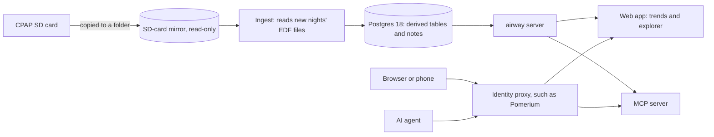

# airway

airway is a self-hosted app for the data a ResMed CPAP, such as the AirSense 10, writes to its SD card. It imports the card's EDF files into Postgres and serves three things from them:

- a phone-first trends page with nightly, weekly, and monthly numbers
- an explorer that slices the data any way you like and gives every query a link you can share
- an MCP server, so AI agents can query the same data and hand you links to what they found

One instance serves one patient.

airway is under construction and doesn't run yet. The [issues](https://github.com/bojanrajkovic/airway/issues) track the build.

## How data flows

## Developing

[docs/development.md](docs/development.md) covers setup, and [docs/README.md](docs/README.md) indexes the rest of the docs, one page per area.

## License

[MIT](LICENSE)
