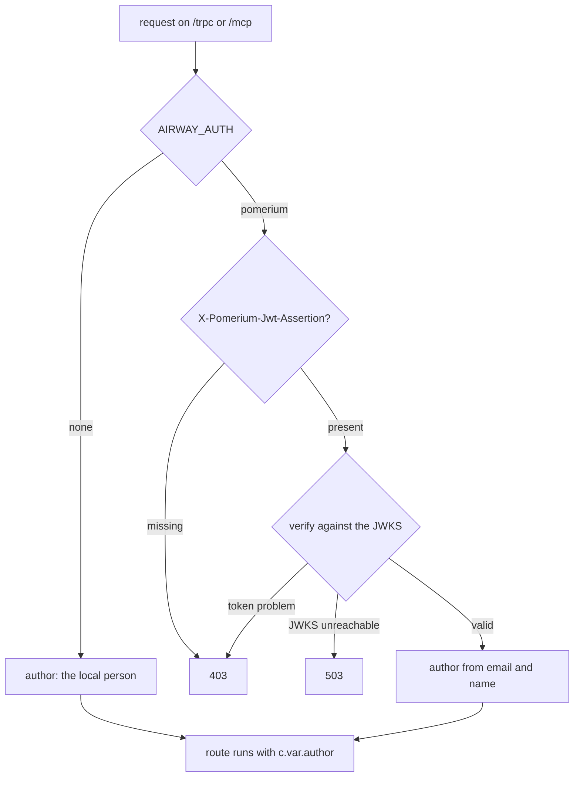

# Auth

airway runs behind an identity proxy that signs in each person and passes a signed token with every request. The server checks that token on the API (`/trpc`) and on MCP (`/mcp`), and turns it into an author: who made the request, and whether it came from the web app or an agent. Notes and query history record that author.

`AIRWAY_AUTH` picks how the server finds the author. It's required and has no default, so a deployment that forgets it stops at startup instead of running open.

| Mode | Who the author is | Used for |
|---|---|---|
| `pomerium` | the person named in the proxy's verified token | production |
| `none` | the person in `AIRWAY_LOCAL_AUTHOR_NAME` and `AIRWAY_LOCAL_AUTHOR_EMAIL`, for every request | local dev, Playwright, and running airway with no proxy |

With `none`, the server logs a warning at every startup. [Configuration](configuration.md) lists each mode's settings.

## What's checked

`createApp` mounts `requireAuthor` on `/trpc/*` and `/mcp`, in one place, so no route under those paths can skip it. Static files and `/healthz` need no author: the bundle is the public repo's code and holds no data, and the proxy guards both hostnames anyway.

The path sets the author's channel: `/trpc` is `web`, and `/mcp` is `mcp`. The app shows an `mcp` author as "Agent for Sam".

With `pomerium`, a token must:

- be signed with ES256 by a key in the JWKS at `AIRWAY_JWKS_URL`. jose fetches the JWKS on first use, caches it, and refetches when a token names a key it hasn't seen.
- name the channel's host as both `aud` and `iss`: `AIRWAY_UI_HOST` on `/trpc`, and `AIRWAY_MCP_HOST` on `/mcp`. Pomerium sets both to the route's bare hostname.
- not have expired.
- carry an `email`.

The server never compares the token with the `Host` or `X-Forwarded-Host` header. Pomerium rewrites `Host` to the internal address, and a client can set `X-Forwarded-Host` to anything.

The author's name is the token's `name` claim. When it's empty, as it is for a Google profile with no name, the name falls back to the email's local part.

## Failures

Every failure answers with a JSON body naming its kind, such as `{"error": "expired"}`, and is logged at `warn` with the kind and channel, never the token.

| Kind | Status | Cause |
|---|---|---|
| `missing_token` | 403 | no `X-Pomerium-Jwt-Assertion` header |
| `invalid_token` | 403 | a bad signature, an unknown key, an algorithm other than ES256 (including `none`), a malformed token, or no email |
| `expired` | 403 | past its `exp` |
| `wrong_issuer` | 403 | `iss` isn't the channel's host. A token for another host fails here first, because jose checks `iss` before `aud` |
| `wrong_audience` | 403 | `aud` isn't the channel's host |
| `jwks_unavailable` | 503 | the JWKS couldn't be fetched or read. The token may be fine, so this is the server's fault, not the caller's |

airway never answers 401. Only Pomerium does, when a session has expired. The web app reloads on a 401, which sends the browser back through sign-in. A 401 from airway would reload the page, Pomerium would serve it on its still-valid session, and the reload would repeat forever.

## Testing token checks

`packages/server/tests/support/tokens.ts` stands in for Pomerium. `testIssuer()` generates an ES256 key, serves its JWKS from a local HTTP server for the file's tests, and mints Pomerium-shaped tokens. The middleware tests run the real check against it, the JWKS fetch included. Everything else, including local dev, runs with `AIRWAY_AUTH=none`.
