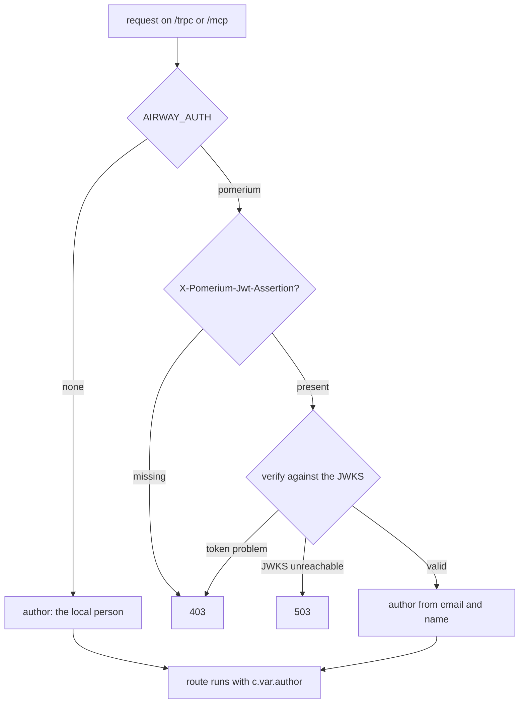

# Auth

airway runs behind an identity proxy that signs in each person and passes a signed token with every request. The server checks that token on the API (`/trpc`) and on MCP (`/mcp`), and turns it into an author. An author says who made the request, and whether it came from the web app or an agent. Notes and query history record that author.

`AIRWAY_AUTH` picks how the server finds the author. It's required and has no default, so a server started without it stops at startup instead of serving requests with no author check.

| Mode | Who the author is | Used for |
|---|---|---|
| `pomerium` | the person named in the proxy's verified token | production |
| `none` | the person in `AIRWAY_LOCAL_AUTHOR_NAME` and `AIRWAY_LOCAL_AUTHOR_EMAIL`, for every request | local dev, Playwright, and running airway with no proxy |

With `none`, the server logs a warning at every startup. [Configuration](configuration.md) lists each mode's settings.

## What's checked

`createApp` mounts `requireAuthor` on `/trpc/*` and `/mcp`, in one place, so every route under those paths runs it. The server serves static files and `/healthz` without running `requireAuthor`.

The path sets the author's channel: `/trpc` is `web`, and `/mcp` is `mcp`. The app shows an `mcp` author as "Agent for Sam".

With `pomerium`, a token must:

- be signed with ES256 by a key in the JWKS at `AIRWAY_JWKS_URL`. jose fetches the JWKS on first use, caches it, and refetches when a token names a key it hasn't seen.
- name the channel's host as both `aud` and `iss`: `AIRWAY_UI_HOST` on `/trpc`, and `AIRWAY_MCP_HOST` on `/mcp`. Pomerium sets both to the route's bare hostname.
- not have expired.
- carry an `email`.

The server compares the token with the configured hosts only, and ignores the `Host` and `X-Forwarded-Host` headers. Pomerium rewrites `Host` to the internal address, and a client can set `X-Forwarded-Host` to anything.

The author's name is the token's `name` claim. When the claim is empty, as it is for a Google profile with no name, the server uses the email's local part.

## How it's built

Each mode is a verifier, which is a function that takes a request's headers and channel and returns the identity it verified. An identity is an email and an optional name. `src/auth/identity.ts` picks the verifier at startup. For every mode, it then records the span, logs each failure, and turns the identity into an author, applying the name fallback. `src/auth/pomerium.ts` is the Pomerium verifier. To add a provider, write a verifier and add an `AIRWAY_AUTH` value.

## Failures

When a token check fails, the server responds with a JSON body that contains the failure kind, such as `{"error": "expired"}`. The server logs verification errors at `warn` with the kind, the channel, and the underlying jose or fetch error. The jose error includes the failed check's code, claim, reason, and message. For a failed claim check, it also includes the token's decoded claims, with the email and name, for debugging. The server leaves the raw token out of the log. The span records the error's class, message, and stack, without the claims.

| Kind | Status | Cause |
|---|---|---|
| `missing_identity` | 403 | no `X-Pomerium-Jwt-Assertion` header |
| `invalid_identity` | 403 | a bad signature, an unknown key, an algorithm other than ES256 (including `none`), a malformed token, or no email |
| `expired` | 403 | past its `exp` |
| `wrong_issuer` | 403 | `iss` isn't the channel's host. A token for another host fails here first, because jose checks `iss` before `aud` |
| `wrong_audience` | 403 | `aud` isn't the channel's host |
| `provider_unavailable` | 503 | the identity provider couldn't be reached; with Pomerium, the JWKS couldn't be fetched or read. The token may be valid, so the status is a server error |

## Testing token checks

`packages/server/tests/support/tokens.ts` stands in for Pomerium. `testIssuer()` generates an ES256 key, serves its JWKS from a local HTTP server for the file's tests, and mints Pomerium-shaped tokens. The middleware tests run the real check against it, the JWKS fetch included. Everything else, including local dev, runs with `AIRWAY_AUTH=none`.
