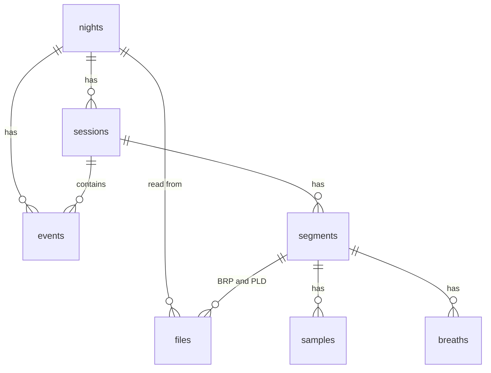

# Data model

This page describes the datasets, the derived tables, their units, and derived_version.

## Datasets

A dataset is the form of a derived table that queries use. It has the table's name and describes each column once. `DATASETS` in `@airway/contract/registry/datasets` lists the five.

| Dataset | One row per | Columns |
|---|---|---|
| `nights` | Night | The machine's `STR.edf` statistics, then airway's own columns: session counts, the longest stretch, event counts, the AHI check, the rule set, and the arrival time |
| `sessions` | Mask-on period | Start, end, duration, and whether it comes from the machine's mask-on times or from the recording files |
| `events` | Event the machine flagged | Type, source, duration, and whether it fell outside every mask-on period |
| `samples` | 2 seconds of therapy | The nine low-rate signals: pressures, leak, respiratory rate, tidal volume, minute ventilation, snore, and flow limitation |
| `breaths` | Breath that airway detects in the flow signal | Duration, amplitude, and inspiratory volume |

`nights` keeps the machine's numbers apart from airway's. The machine's numbers are the primary ones. `ahi` is the AHI that the machine scored, and airway's event counts have their own column names.

airway stores each value as a spelled-out name, such as `obstructive_apnea`, in place of the machine's code.

Each dataset has a grain, the shortest time step its rows can be bucketed into. The grain of `nights` is `night`, because a night's row covers the whole night. The grain of the other four is `2s`. A [query](query.md#the-query-spec) can't bucket finer than the grain.

`events`, `samples`, and `breaths` share three columns. `session` is the mask-on period's number within the night, so a query can break any of the three datasets down by session without a join. `night` is the sleep day. `hour_of_night` is the wall-clock hour in the home time zone.

`registry/columns.ts` defines the columns and units that more than one dataset uses, and each dataset has its own file in the same folder. The `nights` and `samples` tables get their machine-signal columns from these files, so a signal is listed once.

## Columns

A dataset is a list of columns, and each column is described once, in `@airway/contract/registry`. Everything that queries a dataset reads that one description.

`registry/define.ts` has one function per kind of column:

| Function | Role | For |
|---|---|---|
| `signal(name, description)` | metric | A value the machine recorded. Its unit comes from the AirSense table ([Units](#units)) |
| `metric(name, unit, description)` | metric | A value airway computes, in a unit airway chooses |
| `dimension(name, kind, description)` | dimension | An integer or boolean to filter and group by |
| `enumeration(name, values, description)` | dimension | One of a fixed list of spelled-out values |
| `time(name, kind, description)` | time | A timestamp or a night |

A query can group by time and dimension columns, but it can't group by metrics. `operationsFor(column)` returns the filter operations that a column allows. It works them out from the column's kind, so a column's definition doesn't list operations.

Every `nights` metric also has `combine`, which says how airway combines the metric's values over a week or month of nights: `rate`, `median`, `max`, or `mean`. The helpers in `nights.ts` set it from the kind of column they make, and [Trends](trends.md#how-nights-combine) explains each one.

## Column SQL

A column's SQL is a `TrustedSql`: SQL that came from source code and never from a request, so it's safe to put in a statement. Only a computed column has one. Its definition writes the SQL in a `sql` template. The template accepts only another `TrustedSql` or the `homeZone` marker as an interpolated value, so interpolating any other value fails to compile.

A plain column reads the table column with the same name, and the code that builds a statement quotes that name.

```ts
const hour = sql`extract(hour from ts at time zone ${homeZone})::int`;
const hourOfNight = dimension("hour_of_night", "integer", "Wall-clock hour in the home time zone.", hour);

render(hour, { homeZone: 3 });
// extract(hour from ts at time zone $3)::int
```

`homeZone` stands for the `AIRWAY_TIME_ZONE` setting. `render` replaces it with the number of a bound parameter, so the zone stays out of the registry and reaches Postgres as a parameter value.

## Units

A stored value keeps the machine's unit. The app converts some units for display: L/s becomes L/min, and L becomes mL.

A machine signal's unit and decimals come from `@airway/edf`'s AirSense table, which copies each signal's unit and its physical and digital ranges from the real headers. The ranges give the step between two values, and `decimalsForStep(step)` turns the step into the decimals needed to write every value. For example, leak is in L/s with a step of 0.02, so it has 2 decimals. airway computes a breath's amplitude (L/s) and inspiratory volume (L) from the 25 Hz flow signal, so both use the flow signal's decimals. `@airway/edf`'s `COLUMN_UNITS` lists the unit and decimals of every machine signal column and of the two breath columns.

The units are fixed in code because ResMed hasn't changed them: OSCAR hard-codes the same units for the S9, AirSense 10, and AirSense 11. Decoding still uses each file's own step, so a file with a different step decodes correctly. A column that airway computes declares its unit and decimals in the registry.

`toDisplay(value, stored)` and `toStored(value, stored)` convert between the stored and display units. A stored value converts to display and back exactly.

For example, with leak stored in L/s and tidal volume in L, as an AirSense 10 declares them:

| Stored | Shown |
|---|---|
| 0.4 L/s | 24 L/min |
| 1.14 L/s | 68.4 L/min |
| 0.3 L | 300 mL |

`toStored` converts a value typed in display units so that it can be compared with stored values. For example, a leak of 24 L/min becomes 0.4 L/s.

## Derived tables

Everything airway derives from the card's files lives in one Postgres schema, `derived`. `derivedTables(schema)` and `derivedIndexesAndKeys(schema)` in `@airway/contract/derived/ddl` return the statements that create it, and no other code creates a derived table or index. Both take the schema's name, so the same tables can be built in `derived_next` beside the ones in use. `derivedIndexesAndKeys` creates the indexes and the foreign keys from `samples` and `breaths` to `segments`. A load runs `derivedIndexesAndKeys` after it inserts the rows, because building an index once is faster than updating it for every row, and adding a foreign key checks every row in one pass instead of one row at a time. What people and agents write lives in a second schema, `notes`, which [Notes](notes.md) describes.

Every table is UNLOGGED. airway can rebuild the data from the files, so the tables skip the write-ahead log and backups. A crash empties the tables.



| Table | One row per | Key |
|---|---|---|
| `nights` | Night with a folder on the card: the machine's `STR.edf` statistics, then airway's own columns. `possibly_corrupted` is true when one of the night's BRP, PLD, or EVE files doesn't match its `.crc`, has a bad record, or failed the size check | `night` |
| `sessions` | Mask-on period | `night, session` |
| `segments` | BRP file with data | `night, segment` |
| `events` | Machine event. `ts` is the event's start. When the machine writes a duration of 0, `duration` is null and `ts` is the event's end. `session` is null when the night has no sessions | none |
| `samples` | 2 seconds of therapy: the nine PLD signals | none |
| `breaths` | Breath detected in the flow signal. `amplitude` is the breath's peak-to-trough flow, and `duration` runs to the next breath's start, so a pause belongs to the breath before it | none |
| `files` | Imported file, with its size, SHA-256, and ctime. `night` is null for `STR.edf` and `Identification.tgt`. `segment` names the segment a BRP or PLD file's data belongs to, so a segment's files are one join away, including both halves of a split PLD. `segment` is null for every other file, for a header-only BRP or PLD file, and for a PLD file that doesn't overlap any segment. `checksum` is `match` or `mismatch` for a file that ingest compares with its `.crc`, and `unchecked` for any other file. `bad_records` counts the records whose Crc16 doesn't match. It's null when ingest doesn't check the file's records | `path` |
| `device` | Machine: serial and model | `serial` |
| `settings_changes` | Setting that changed on a used day, compared with the previous used day | `night, setting` |
| `daily_usage` | Day `STR.edf` covers, used or not | `day` |
| `period_percentiles` | Week or month, and signal (leak or mask pressure): the P50 and P95 of its samples | `period, period_start, signal` |
| `meta` | The schema: its `derived_version` and when it was built | one row |

### Keys

Deleting a `nights` row deletes that night's rows from `files`, `sessions`, `segments`, `events`, `samples`, and `breaths`, through `ON DELETE CASCADE` foreign keys. To rebuild a night, ingest deletes the night's `nights` row and then inserts the new rows, parent tables first. A segment can't be deleted while a `files` row names it.

A sample or breath references its segment together with the segment's session, so its `session` can't disagree with the segment's.

`settings_changes`, `daily_usage`, and `period_percentiles` don't reference `nights`, because they cover days and periods that have no `nights` row.

### Values

Signal values are `double precision`. A value written as the decimal text `0.4` is stored as exactly 0.4, and `leak = 0.4` matches it. A `real` column wouldn't match: Postgres widens it to compare, and its 0.4 becomes 0.4000000059604645.

Text columns with a fixed set of values, such as an event's `type`, have a CHECK constraint, built from the lists in `derived/values.ts`. The registry's enum columns read the same lists.

### Indexes

- `(night, ts)` on `samples`, `breaths`, and `events`.
- `(ts)` on `samples`, because a "latest samples" query would otherwise scan the table.
- `(night, leak)` and `(night, mask_pressure)` on `samples`. They hand `percentile_cont` a night's values already sorted.

### Period percentiles

`periodPercentiles(schema)` in `@airway/contract/derived/percentiles` returns the one statement that fills `period_percentiles` from `samples`. It takes `percentile_cont(0.5)` and `percentile_cont(0.95)` of leak and mask pressure for each week, starting Monday, and each month. Because it uses `percentile_cont`, a stored value equals a query-time percentile over the same samples.
