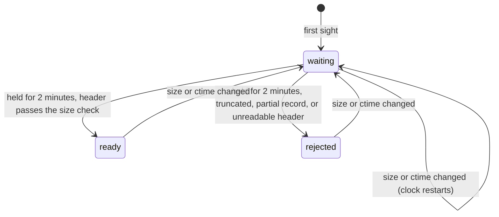
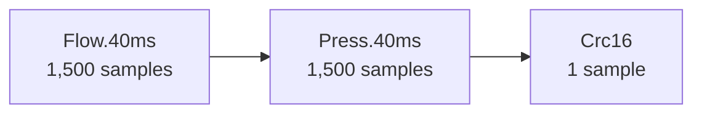
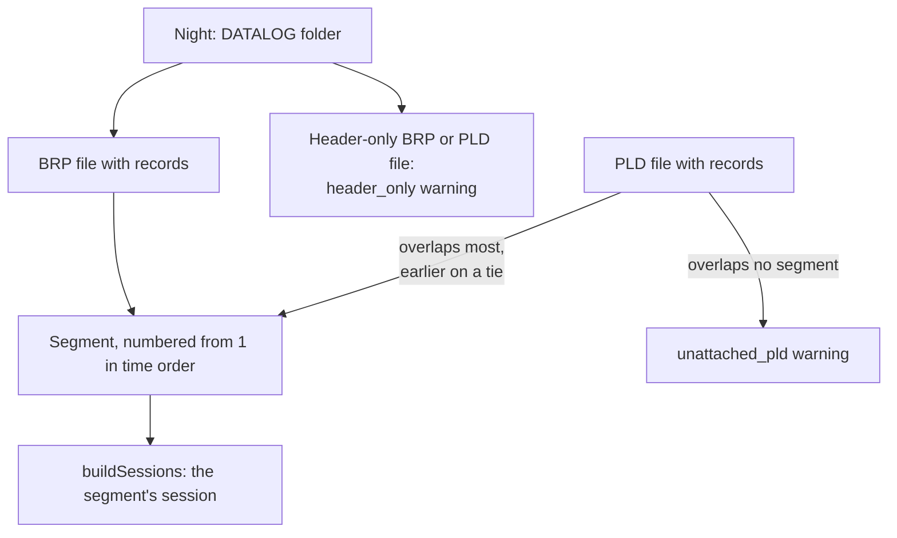

# Ingest

How airway reads the CPAP data folder and builds the derived tables.

The importer isn't finished. This page describes the parts that are built, and the rules ingest shares with the synthetic data generator.

## Scanning

Each poll starts with `scanCpapData(ctx)` in `packages/server/src/ingest/scan.ts`. It lists the files ingest reads from the CPAP data folder (`AIRWAY_CPAP_DATA_PATH`) without opening any of them:

```
STR.edf, Identification.tgt,         night = null
Identification.crc
DATALOG/YYYYMMDD/*_BRP.edf           night = the folder's date
DATALOG/YYYYMMDD/*_PLD.edf
DATALOG/YYYYMMDD/*_EVE.edf
DATALOG/YYYYMMDD/*_{BRP,PLD,EVE}.crc
```

Each `ScannedFile` has its path relative to the folder, its kind, its night, and the size and ctime from one `stat` call. ctime only tells ingest that a file changed. Ingest never compares it with its own clock, because nothing guarantees the folder's clock matches airway's.

A `.crc` file holds the checksums of the file it's named after. The scan keeps the `.crc` of each file it lists, so the checksums can be checked at import, and a `.crc` that arrives late re-plans its night. Everything else is counted by reason and skipped: SAD and CSL files and their `.crc` files, other entries, and folders whose names aren't real dates. The `ingest.scan` span records the file count and each skip count. A folder with no `DATALOG` yet has no nights. Any read error fails the scan with `read_failed`, and the next poll tries again.

`readEdfFile(ctx, path)` in `ingest/edf.ts` reads one file's header with `readFileHeader` inside an `edf.read_file` span. The span records the path, the format, the size verdict, the whole records on disk, and the warning count. Each warning, such as a `startdate_mismatch`, becomes an `edf.warning` span event with its kind and details, and is logged at `warn` with the file's path.

## Readiness

Files in the CPAP data folder can change while airway polls, so a file can be half-written. `checkVersions(ctx, seen, scan, now)` in `ingest/versions.ts` sorts each scanned file into ready, waiting, or rejected. `seen` is the poller's memory between polls, one `SeenFile` per path. It holds the size, ctime, when that size and ctime were first seen, the parsed header, and the hash.



- A file waits until its size and ctime have held for 2 minutes, measured on airway's clock. The pure `checkReadiness` in `ingest/readiness.ts` makes that call.
- Its header is read through `readEdfFile` only when its size or ctime changed, and then the size check decides. Identification.tgt and `.crc` files aren't EDF, so their size alone decides.
- A header that can't be read for an I/O reason (`read_failed`) is logged and read again on every poll, without restarting the clock. A header that won't parse is rejected as `unreadable` until the file changes, because the same bytes give the same answer.
- A rejected file is logged once per version at `warn`, with its path, reason, size, declared records, and records on disk.
- A ready file is hashed once per version, with SHA-256 streamed from disk in an `ingest.hash` span. Its version is its path, size, and hash.
- An unchanged folder costs only the scan: no header reads and no hashes. After a restart, `seen` starts empty, so the first poll reads every header and the second hashes every file.
- A path missing from the scan is forgotten. A file that can't be hashed is logged and forgotten, so it waits and the next poll starts it over.

The `ingest.readiness` span records how many files are ready, waiting, and rejected.

## Planning

`planNights(states, imported)` in `ingest/planner.ts` turns the files' readiness into a `NightPlan`. `imported` holds the versions in `derived.files`: path, size, and SHA-256.

- **A night is imported** when one of its ready files is new or has a different size or hash, and nothing holds it.
- **A night waits whole** while any of its files waits, so it's never imported from half its files. It also waits while STR.edf isn't ready or has no record for it. STR.edf's header gives its first day, and each whole record is one more day.
- **A rejected file is left out**, and its night imports without it, so a file that never finishes can't hold the night forever. Rejected files never get a `files` row. When the complete file arrives later, it has no imported version, so it re-plans the night and the night's rows are rebuilt with it.
- **A file that leaves the CPAP data folder changes nothing.** The night keeps its rows until the next rebuild, which reads only what's in the folder.
- **`rewriteStrTables`** is true when STR.edf or Identification.tgt has a new ready version. Both feed the STR.edf tables.

Import starts at the first DATALOG folder, because only folders give nights. STR.edf's older days feed only the STR.edf tables.

## Reading EDF files

`@airway/edf` reads the card's EDF files. BRP, PLD, SAD, and `STR.edf` are plain EDF. EVE and CSL are EDF+D, and hold annotations.

### Headers

`readHeader(bytes, size)` parses a header and returns `{header, size, warnings}`:

- `header` holds every field ingest uses: the format, the start time on the device clock, the patient and recording fields, the header length, the declared record count, the record length in seconds, and each signal's label, unit, physical and digital ranges, and samples per record.
- `size` is `checkFileSize`'s verdict for the file's size on disk: `read`, `skip`, or `reject`. Only a file whose verdict is `read` can be decoded; `isReadable(file)` checks that.
- `warnings` lists anything the header contradicts without stopping the read. A `startdate_mismatch` means the recording field's `Startdate` names a different day from the header's start date.

`readFileHeader(path)` reads only a file's header from disk and checks the file's size against it. The scan uses it on every poll, so it never reads records. A header's length depends on its signal count, 1,024 bytes for BRP and about 21 KB for `STR.edf`, so it reads the first 256 bytes, which say how long the header is, then the rest. A file it can't open returns `read_failed`.

`readHeader(bytes, size)` parses bytes already in memory. `bytes` must hold the whole header, and `size` defaults to `bytes.length`. Bytes that end inside the header return `header_too_short`, with `headerBytes` set to the header's length.

The start date has a two-digit year. As EDF+ specifies, 85 to 99 mean 19xx and the rest mean 20xx.

A field that won't parse returns `bad_field` with the field's name and text.

### Data records

After the header come the data records, back to back. Each record holds every signal's next run of samples, in header order, as little-endian int16 values. On the card, every record ends with a Crc16 sample. A BRP record holds 60 s:



`readSignals(bytes, file, labels, range)` returns one `Float64Array` per label, in physical units:

```ts
const signals = readSignals(bytes, file, ["Flow.40ms", "Press.40ms"], { fromRecord: 3, toRecord: 5 });

if (signals.isErr()) {
  return err(signals.error); // missing_signal, range_out_of_bounds, or bytes_too_short
}

const flow = signals.value["Flow.40ms"];
```

- It reads every whole record on disk by default, including records past the header's count. The range follows `Array.slice`: 0-based, with `toRecord` excluded.
- A physical value is `physicalMin + (digital - digitalMin) × step`. A digital value outside the signal's digital range reads as NaN, because the card writes -1 there to mean "no value".
- Signals that weren't asked for, Crc16 among them, are skipped by byte offset.
- Both readers need the file's bytes through its last record. Bytes that end sooner, such as a header read alone, return `bytes_too_short`.

### Annotations

EVE and CSL are EDF+D files. Their records last 0 s and hold an `EDF Annotations` signal of time-stamped annotation lists (TALs). Each TAL is an onset in seconds from the file's start, an optional duration, and one or more texts:

```
+0 \x14 \x14 \0                        timekeeping TAL: no text
+1260 \x15 12 \x14 Hypopnea \x14 \0     onset 1260 s, duration 12 s
```

`readAnnotations(bytes, file)` returns `{onset, duration, label}` for every text, in record order, with labels as written, "Recording starts" included. It drops timekeeping TALs, which on the card are always `+0`. A missing or empty duration reads as 0. A TAL that doesn't parse returns `bad_annotation` with its record number.

## Segments

A segment is the stretch one BRP file recorded. The machine sometimes starts a new BRP file in the middle of a mask-on period, so a session can hold several segments. `planSegments` in `packages/server/src/ingest/segments.ts` builds a night's segments from its ready BRP and PLD files, then its sessions:



- A file's span starts at its header's start time on the device clock and lasts the record length times the number of whole records on disk. The record count comes from the file's size, so a header that undercounts still gives the full segment.
- Each BRP file with at least one record is its own segment, even when the next one starts seconds later, because the gap between them holds no signal.
- Each PLD file with records attaches to the segment it overlaps most. Both halves of a split PLD overlap the same BRP file and land on its segment. A PLD file starts about 1 s after its BRP file and still overlaps it almost entirely.
- A header-only BRP or PLD file gets a `header_only` warning instead of a segment. A PLD file that overlaps no segment, such as one whose BRP file was rejected, gets an `unattached_pld` warning with its span. The caller logs each warning.
- The attached BRP and PLD files name their segment in their `files` rows. Only BRP and PLD files build segments.

## Sessions

A session is one mask-on period. `buildSessions` in `@airway/contract/derived/sessions` builds a night's sessions from `STR.edf` and the night's BRP segments:

1. Each used `STR.edf` slot is a session with `source = str`. Its times are the slot's minutes since noon on the device clock, converted with the home zone's winter offset ([Configuration](configuration.md#the-cpaps-clock)). A slot 0 with a mask-off but no mask-on starts at noon. A slot whose mask-on and mask-off are the same minute lasted under a minute and makes no session, so that night's count can't match `MaskEvents`.
2. Each BRP segment joins the `str` session it overlaps most, allowing 60 s on either side, because `STR.edf` keeps whole minutes.
3. `STR.edf` has only 10 slots, but `MaskEvents` counts every period. Segments that match no slot join their neighbor when the gap is 90 s or less, and each run becomes a session with `source = derived`.
4. Sessions are numbered from 1 in time order. A night is flagged approximate when its session count differs from `MaskEvents / 2`.

The 90 s join can't be exact: the machine starts new BRP files inside one period, and some gaps between files are longer than some short mask-off breaks. The approximate flag tells the reader when the counts disagree.

`assignEvents` puts each event in the session that contains it, allowing 60 s on either side. An event outside every session goes to the nearest one and is marked `outside_mask_on`, so the sessions' counts add up to the night's total. On a night with no sessions, an event has no session.

## STR.edf

`STR.edf` is the machine's daily summary, with one 86,400 s record per day. `readStr(bytes, file)` in `packages/server/src/ingest/str.ts` reads it into one `StrDay` per record, oldest first. `StrDay` lives in `@airway/contract/derived/str`, because synthetic builds the same days from its model.

- A day's date is the header's start date plus the record's index. When the `Date` signal disagrees, `readStr` returns a `date_mismatch` warning with both dates, and the caller logs it.
- A day is unused when `OnDuration` is -1. The machine writes -1 for every other signal that day too, so an unused day has only its date.
- A used day has its `nights` column values, its S.* settings by name, `MaskEvents`, and the 10 `MaskOn` and `MaskOff` slots. Values are physical, rounded to their signal's step, and null where the machine wrote -1. The slots stay minutes since noon on the device clock, with NaN for an unused slot, because `buildSessions` converts them with the home zone's winter offset.

`STR.edf` covers months before the first DATALOG folder, so `readStr` returns every day. Each consumer picks the days it needs.

## Settings changes

`settingsChanges(days, from)` in `@airway/contract/derived/settings` turns `STR.edf`'s days into `settings_changes` rows. It compares each used day's S.* settings with the previous used day's, and returns a row for each setting that changed. Only days on or after `from` get rows. Ingest passes the first imported night as `from`.

The comparison uses every used day in `STR.edf`, including days before `from` and days with no DATALOG folder. So the first imported night shows a change made before it, and a change made on a day with no folder gets its row on that day. Unused days are skipped. Four settings get names: `min_pressure`, `max_pressure`, `epr_level`, and `ramp_time`. The rest keep their S.* label.

## Events

An EVE annotation's onset marks the end of the event, so an event starts at its onset minus its duration.
