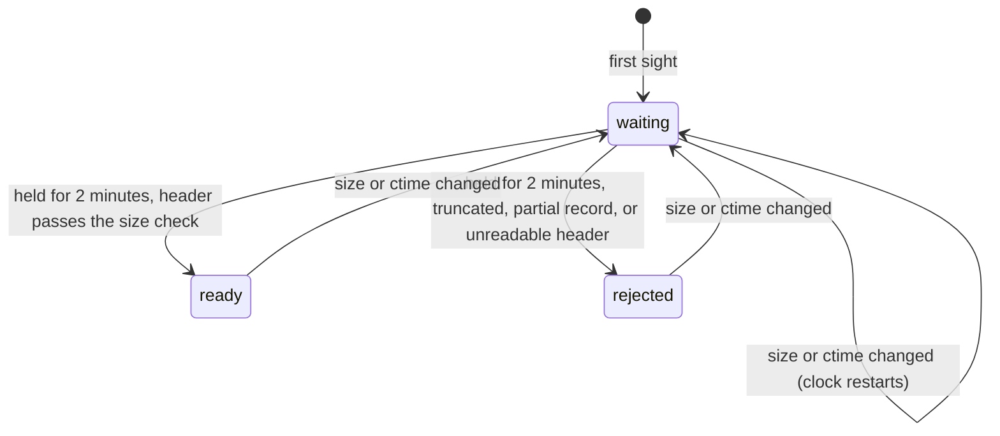
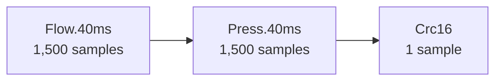
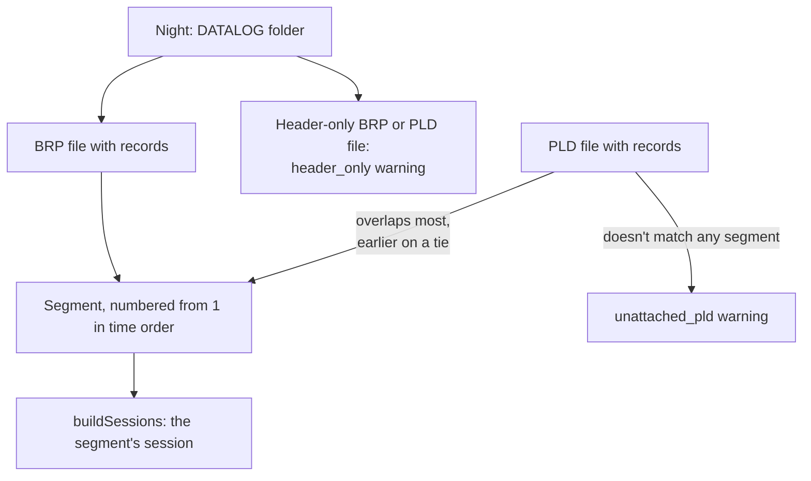
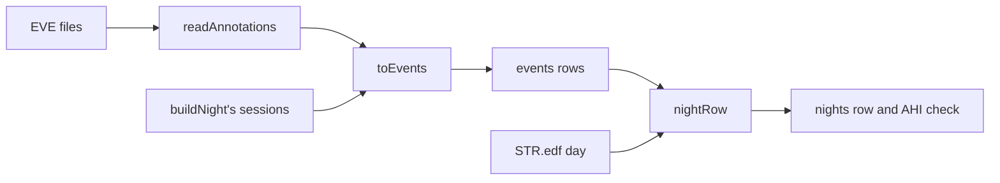

# Ingest

This page explains how airway reads the CPAP data folder and builds the derived tables.

The importer isn't finished. This page describes the parts that are built, and the rules that ingest shares with the synthetic data generator.

## Scanning

Each poll starts with `scanCpapData(ctx)` in `packages/server/src/ingest/scan.ts`. It lists the files that ingest reads from the CPAP data folder (`AIRWAY_CPAP_DATA_PATH`) without opening any of them:

```
STR.edf, Identification.tgt,         night = null
Identification.crc
DATALOG/YYYYMMDD/*_BRP.edf           night = the folder's date
DATALOG/YYYYMMDD/*_PLD.edf
DATALOG/YYYYMMDD/*_EVE.edf
DATALOG/YYYYMMDD/*_{BRP,PLD,EVE}.crc
```

Each `ScannedFile` has its path relative to the folder, its kind, its night, and the size and ctime from one `stat` call. ctime only tells ingest that a file changed. Ingest never compares ctime with airway's clock, because the folder's clock can differ from airway's.

A `.crc` file holds the checksums of the file it's named after. The scan keeps the `.crc` of each file it lists, so import can verify the checksums. When a `.crc` arrives late, ingest plans that file's night again. The scan skips everything else and counts the skips by reason: SAD and CSL files and their `.crc` files, other entries, and folders whose names aren't real dates. The `ingest.scan` span records the file count and each skip count. The scan finds nights only after the CPAP data folder has a `DATALOG` folder. Any read error fails the scan with `read_failed`, and the next poll tries again.

`readEdfFile(ctx, path)` in `ingest/edf.ts` reads one file's header with `readFileHeader` inside an `edf.read_file` span. The span records the path, the format, the size verdict, the number of whole records on disk, and the warning count. Each warning, such as a `startdate_mismatch`, becomes an `edf.warning` span event with its kind and details, and is logged at `warn` with the file's path.

## Readiness

Files in the CPAP data folder can change while airway polls, so a file can be half-written. `checkVersions(ctx, seen, scan, now)` in `ingest/versions.ts` sorts each scanned file into ready, waiting, or rejected. The poller keeps `seen` between polls, with one `SeenFile` per path. A `SeenFile` holds the file's size, its ctime, the time when that size and ctime were first seen, the parsed header, and the hash.



- A file waits until its size and ctime have held for 2 minutes, measured on airway's clock. `checkReadiness`, a pure function in `ingest/readiness.ts`, decides whether a file has waited long enough.
- `checkVersions` reads a file's header through `readEdfFile` only when the file's size or ctime changed, and the size check then decides whether the file is ready or rejected. Identification.tgt and `.crc` files aren't EDF, so `checkVersions` skips the header read, and they're ready once their size and ctime have held for 2 minutes.
- When an I/O error (`read_failed`) stops a header read, `checkVersions` logs the error and reads the header again on the next poll, and the 2-minute wait keeps running. A file whose header won't parse is rejected as `unreadable` until the file changes, because parsing the same bytes would fail the same way.
- A rejected file is logged once per version at `warn`, with its path, reason, size, declared records, and records on disk.
- `checkVersions` hashes a ready file once per version. It streams the file from disk through SHA-256 inside an `ingest.hash` span. Its version is its path, size, and hash.
- When nothing in the folder changed, a poll runs the scan and skips the header reads and the hashing. After a restart, `seen` starts empty, so the first poll reads every header and the second hashes every file.
- `checkVersions` drops a path from `seen` when the scan no longer lists it. When a file can't be hashed, `checkVersions` logs the failure and drops the file from `seen`, so the next poll treats it as a new file and it waits again.

The `ingest.readiness` span records how many files are ready, waiting, and rejected.

## Planning

`planNights(states, imported)` in `ingest/planner.ts` turns the files' readiness into a `NightPlan`. `imported` holds the versions in `derived.files`: path, size, and SHA-256.

- **A whole night waits** while any of its files waits, so ingest never imports a night from only some of its files. The night also waits until STR.edf is ready and has a record for that night. STR.edf's header names the day of its first record, and each whole record after that is the next day.
- **A night that isn't waiting is imported** when one of its ready files is new or has a different size or hash.
- **A rejected file is left out.** Ingest imports the night without the file, so a truncated file can't block the night indefinitely. Ingest writes `files` rows only for the files it imports. When the complete file arrives later, the planner treats it as a new file, and ingest rebuilds the night's rows with it.
- **A night keeps its rows when one of its files leaves the CPAP data folder.** The rows stay until the next rebuild, which reads only what's in the folder.
- **`rewriteStrTables`** is true when STR.edf or Identification.tgt has a new ready version. Both feed the STR.edf tables.

Import starts at the first DATALOG folder, because every night comes from a DATALOG folder. STR.edf's older days feed only the STR.edf tables.

## Reading EDF files

`@airway/edf` reads the card's EDF files. BRP, PLD, SAD, and `STR.edf` are plain EDF. EVE and CSL are EDF+D, and hold annotations.

### Headers

`readHeader(bytes, size)` parses a header and returns `{header, size, warnings}`:

- `header` holds every field that ingest uses: the format, the start time on the device clock, the patient and recording fields, the header length, the declared record count, the record length in seconds, and each signal's label, unit, physical and digital ranges, and samples per record.
- `size` is `checkFileSize`'s verdict for the file's size on disk: `read`, `skip`, or `reject`. `readSignals` and `readAnnotations` take a `ReadableEdfFile`, which is a file whose verdict is `read`. The `isReadable(file)` type guard narrows an `EdfFile` to a `ReadableEdfFile`.
- `readHeader` decodes header text as UTF-8, which is how the machine writes it, and replaces an invalid byte with U+FFFD.
- `warnings` lists each inconsistency that `readHeader` found in the header and read past. A `startdate_mismatch` means the recording field's `Startdate` names a different day from the header's start date.

`readFileHeader(path)` reads only a file's header from disk and checks the file's size against it. The scan calls `readFileHeader` on every poll, so `readFileHeader` never reads records. A header's length depends on its signal count. A BRP header is 1,024 bytes, and `STR.edf`'s is about 21 KB. `readFileHeader` reads the first 256 bytes, which say how long the header is, and then reads the rest of the header. `readFileHeader` returns `read_failed` for a file it can't open.

`readHeader(bytes, size)` parses bytes already in memory. `bytes` must hold the whole header, and `size` defaults to `bytes.length`. When `bytes` ends inside the header, `readHeader` returns `header_too_short`, with `headerBytes` set to the header's length.

The start date has a two-digit year. As EDF+ specifies, 85 to 99 mean 19xx and the rest mean 20xx.

`readHeader` returns `bad_field`, with the field's name and text, for a field that won't parse.

### Data records

After the header come the data records, back to back. Each record holds every signal's next run of samples, in header order, as little-endian int16 values. On the card, every record ends with a Crc16 sample. A BRP record holds 60 s:



`readSignals(bytes, file, labels, range)` returns one `Float64Array` per label, in physical units:

```ts
const signals = readSignals(bytes, file, ["Flow.40ms", "Press.40ms"], { fromRecord: 3, toRecord: 5 });

if (signals.isErr()) {
  return err(signals.error); // missing_signal, range_out_of_bounds, or bytes_too_short
}

const flow = signals.value["Flow.40ms"];
```

- It reads every whole record on disk by default, including records past the header's count. The range follows `Array.slice`: 0-based, with `toRecord` excluded.
- A physical value is `physicalMin + (digital - digitalMin) × step`. A digital value outside the signal's digital range reads as NaN, because the machine writes -1 there to mean "no value".
- Signals that weren't asked for, Crc16 among them, are skipped by byte offset.
- `readSignals` and `readAnnotations` both need the file's bytes through its last record. When the bytes end sooner, as they do after a header-only read, each function returns `bytes_too_short`.

### Annotations

EVE and CSL are EDF+D files. Their records last 0 s and hold an `EDF Annotations` signal of time-stamped annotation lists (TALs). Each TAL is an onset in seconds from the file's start, an optional duration, and one or more texts:

```
+0 \x14 \x14 \0                        timekeeping TAL: no text
+1260 \x15 12 \x14 Hypopnea \x14 \0     onset 1260 s, duration 12 s
```

`readAnnotations(bytes, file)` returns `{onset, duration, label}` for every text, in record order, with labels as written, "Recording starts" included. It drops timekeeping TALs, which on the card are always `+0`. A missing or empty duration reads as 0. `readAnnotations` returns `bad_annotation`, with the record number, for a TAL that doesn't parse.

## Segments

A segment is the stretch of time that one BRP file recorded. The machine sometimes starts a new BRP file in the middle of a mask-on period, so a session can hold several segments. `planSegments` in `packages/server/src/ingest/segments.ts` builds a night's segments from the night's ready BRP and PLD files, and then builds the night's sessions:



- A file's span starts at its header's start time on the device clock and lasts the record length times the number of whole records on disk. The record count comes from the file's size, so a file whose header undercounts still produces the full segment.
- Each BRP file with at least one record is its own segment, even when the next one starts seconds later, because the recording stops in the gap between them.
- Each PLD file with records attaches to the segment it overlaps most. Both halves of a split PLD overlap the same BRP file and attach to its segment. A PLD file starts about 1 s after its BRP file and still overlaps it almost entirely.
- `planSegments` skips a header-only BRP or PLD file and returns a `header_only` warning for it.
- For a PLD file that doesn't overlap any segment, `planSegments` returns an `unattached_pld` warning with the file's start and end. One cause is a rejected BRP file.
- The `files` row of each attached BRP or PLD file names the file's segment. `planSegments` builds segments only from BRP and PLD files.

`buildNight(ctx, input)` runs `planSegments` inside an `ingest.segments` span. The span records the night, the number of segments, sessions, and warnings, and whether the sessions are approximate. Each warning becomes an `ingest.segment_warning` span event with its kind and the file's path. The event for an unattached PLD file also records the file's start and end. `buildNight` logs each warning at `warn` with the night.

## Sessions

A session is one mask-on period. `buildSessions` in `@airway/contract/derived/sessions` builds a night's sessions from `STR.edf` and the night's BRP segments:

1. Each used `STR.edf` slot is a session with `source = str`. Its times are the slot's minutes since noon on the device clock, converted with the home zone's winter offset ([Configuration](configuration.md#the-cpaps-clock)). A slot 0 with a mask-off but no mask-on starts at noon. `buildSessions` skips a slot whose mask-on and mask-off are the same minute, because the period lasted under a minute. That night's session count then can't match `MaskEvents`.
2. Each BRP segment joins the `str` session it overlaps most, allowing 60 s on either side, because `STR.edf` keeps whole minutes.
3. `STR.edf` has only 10 slots, but `MaskEvents` counts every period. Segments that don't match a slot join their neighbor when the gap is 90 s or less, and each run becomes a session with `source = derived`.
4. Sessions are numbered from 1 in time order. A night is flagged approximate when its session count differs from `MaskEvents / 2`.

The 90 s join can't be exact: the machine starts new BRP files inside one period, and some gaps between files are longer than some short mask-off breaks. The approximate flag tells the reader when the counts disagree.

`assignEvents` puts each event in the session that contains it, allowing 60 s on either side. An event outside every session goes to the nearest one and is marked `outside_mask_on`, so the sessions' counts add up to the night's total. On a night without sessions, `assignEvents` leaves each event's session empty.

## STR.edf

`STR.edf` is the machine's daily summary, with one 86,400 s record per day. `readStr(bytes, file)` in `packages/server/src/ingest/str.ts` reads it into one `StrDay` per record, oldest first. `StrDay` is defined in `@airway/contract/derived/str`, because the synthetic data generator builds the same days from its model.

- A day's date is the header's start date plus the record's index. When the `Date` signal disagrees, `readStr` returns a `date_mismatch` warning with both dates, and the caller logs it.
- A day is unused when `OnDuration` is -1. The machine writes -1 for every other signal that day too, so an unused day has only its date.
- A used day has its `nights` column values, its S.* settings by name, `MaskEvents`, and the 10 `MaskOn` and `MaskOff` slots. Values are physical, rounded to their signal's step, and null where the machine wrote -1. The slots stay minutes since noon on the device clock, with NaN for an unused slot, because `buildSessions` converts them with the home zone's winter offset.

`STR.edf` covers months before the first DATALOG folder, so `readStr` returns every day. Each consumer picks the days it needs.

## Settings changes

`settingsChanges(days, from)` in `@airway/contract/derived/settings` turns `STR.edf`'s days into `settings_changes` rows. It compares each used day's S.* settings with the previous used day's, and returns a row for each setting that changed. Only days on or after `from` get rows. Ingest passes the first imported night as `from`.

The comparison uses every used day in `STR.edf`, including days before `from` and days with no DATALOG folder. So the first imported night shows a change made before it, and the row for a change made on a day with no folder has that day's date. Unused days are skipped. `settingsChanges` names four settings: `min_pressure`, `max_pressure`, `epr_level`, and `ramp_time`. The rest keep their S.* label.

## Events

EVE files hold the events that the machine scored, such as apneas and hypopneas. `scoreNight(ctx, input)` in `ingest/events.ts` reads a night's EVE files, turns their annotations into `events` rows, builds the night's `nights` row, and runs the AHI (apnea-hypopnea index) check:



`toEvents(night, files, sessions)` does the conversion:

- Label matching ignores case. "Obstructive Apnea", "Central Apnea", "Apnea", "Hypopnea", and "Arousal" map to their event types. `EVENT_LABELS` in `@airway/edf/airsense` defines these labels, and the synthetic generator writes the same labels. `toEvents` drops "Recording starts" and turns any other label into an `other` event, with the original text in its `label`.
- An onset marks the event's end, so an event starts at its onset minus its duration. The machine doesn't time hypopneas and arousals, so it writes a duration of 0 for them. `toEvents` stores that 0 as a null `duration`, and those events start at their onset.
- `toEvents` merges the events from all of a night's EVE files in time order, and `assignEvents` places each event in a session.

`scoreNight` then calls `nightRow` ([Scoring](scoring.md#night-rows)) with the rule set that `ruleSetFor` picks from the patient's birth date. `scoreNight` runs inside an `ingest.events` span, which records the night, the number of EVE files, the number of events, and `ahi_check`. For each unknown label in a file, `scoreNight` adds one `ingest.unknown_event_label` span event and writes one `warn` log. Both include the label, the file's path, and how many times the label appears in that file. An AHI mismatch adds an `ingest.ahi_mismatch` span event and a `warn` log. Both include airway's AHI in tenths, and the machine's AHI when STR.edf records an AHI for that night.

An EVE file that fails to read or parse fails the night, because the AHI check would be wrong for a night with only some of its events. The failure adds an `ingest.event_file_failed` span event and an `error` log with the file's path and the error's kind.

Ingest skips CSL files, which hold the machine's Cheyne-Stokes respiration periods. Before ingest can read CSL files, airway needs a sample CSL file that contains a period, and `EVENT_TYPES` needs a type for those periods.
