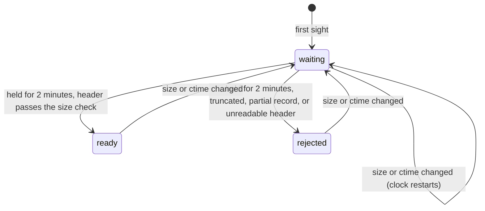
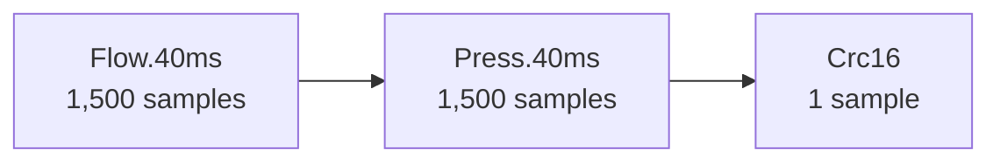
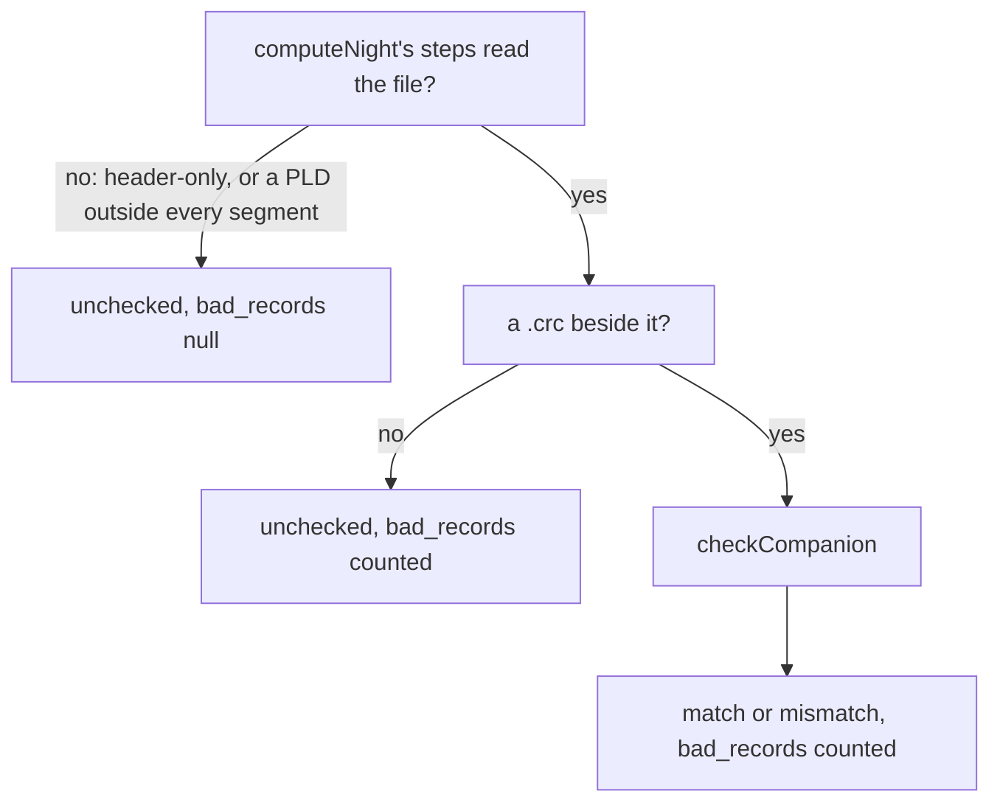
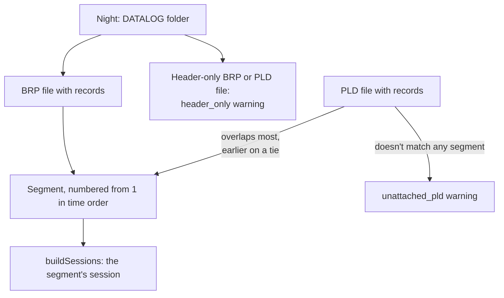
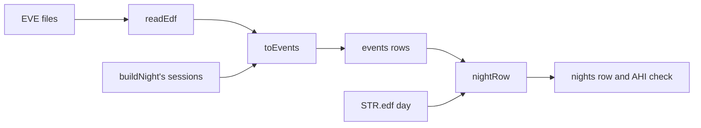
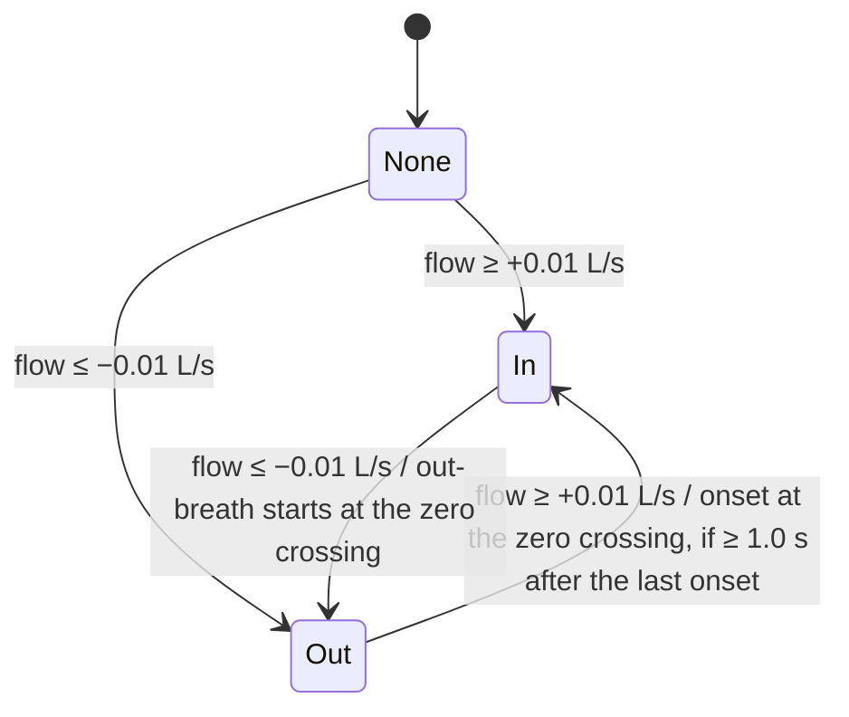
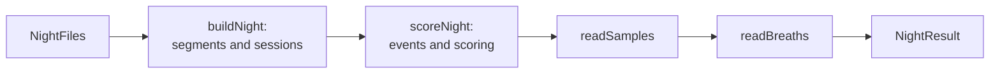
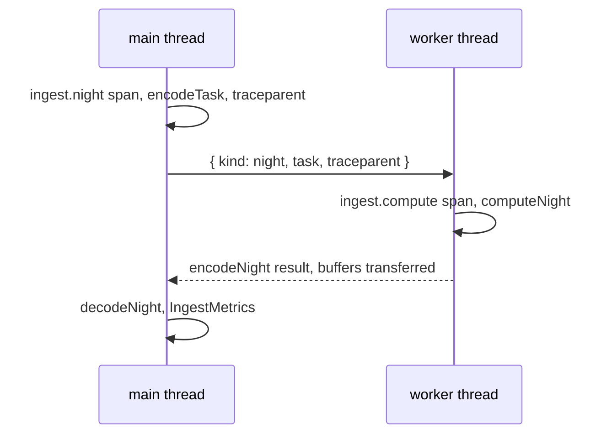

# Ingest

This page explains how airway reads the CPAP data folder and builds the derived tables.

The importer isn't finished. This page describes the parts that are built, and the rules that ingest shares with the synthetic data generator.

## Scanning

Each poll starts with `scanCpapData(ctx)` in `packages/server/src/ingest/scan.ts`. It lists the files that ingest reads from the CPAP data folder (`AIRWAY_CPAP_DATA_PATH`) without opening any of them:

```
STR.edf, Identification.tgt,         night = null
Identification.crc
DATALOG/YYYYMMDD/*_BRP.edf           night = the folder's date
DATALOG/YYYYMMDD/*_PLD.edf
DATALOG/YYYYMMDD/*_EVE.edf
DATALOG/YYYYMMDD/*_{BRP,PLD,EVE}.crc
```

Each `ScannedFile` has its path relative to the folder, its kind, its night, and the size and ctime from one `stat` call. ctime only tells ingest that a file changed. Ingest never compares ctime with airway's clock, because the folder's clock can differ from airway's.

`nightFileType(name)` in `@airway/edf/airsense` reads a night file's type from the end of its name, such as `_BRP.edf` or `_BRP.crc`. The scan decides which types to list and which to skip. A `.crc` file holds the checksums of the file it's named after. The scan keeps the `.crc` of each file it lists, so import can verify the checksums. When a `.crc` arrives late, ingest plans that file's night again. The scan skips everything else and counts the skips by reason: SAD and CSL files and their `.crc` files, other entries, and folders whose names aren't real dates. The `ingest.scan` span records the file count and each skip count. The scan finds nights only after the CPAP data folder has a `DATALOG` folder. Any read error fails the scan with `read_failed`, and the next poll tries again.

`ingest/edf.ts` reads EDF files from disk and runs each read in its own span. `@airway/edf` only parses bytes. Both readers take a path relative to the CPAP data folder, and every error they return includes that path. When the file system can't read a file, the error is `read_failed`, with the file system's error in `cause`.

- `readEdfHeader(ctx, path)` reads only a file's header and checks the file's size against it, in an `edf.read_header` span. A header's length depends on its signal count: a BRP header is 1,024 bytes, and `STR.edf`'s is about 21 KB. `readEdfHeader` reads the first 256 bytes, which include the header's length, and then reads the rest of the header. It skips the records because the readiness check reads every file's header. The span records the path, the format, the size verdict, the number of whole records on disk, and the warning count.
- `readEdfFile(ctx, path, type)` reads a whole file and parses it with `readEdf`, in an `edf.read_file` span. It also runs both [checksum checks](#checksums) and returns their results with the file. The EVE, PLD, and BRP readers use it. The span records:

  - the path
  - the format
  - the number of whole records on disk
  - the warning count
  - the checksum result
  - the number of bad records

`readEdfHeader` turns each header warning, such as a `startdate_mismatch`, into an `edf.warning` span event with the warning's kind and details, and logs the warning at `warn` with the file's path. `readEdfFile` only counts the warnings, because `readEdfHeader` logged them when the readiness check read the header.

## Readiness

Files in the CPAP data folder can change while airway polls, so a file can be half-written. `checkVersions(ctx, seen, scan, now)` in `ingest/versions.ts` sorts each scanned file into ready, waiting, or rejected. The poller keeps `seen` between polls, with one `SeenFile` per path. A `SeenFile` holds the file's size, its ctime, the time when that size and ctime were first seen, the parsed header, and the hash.



- A file waits until its size and ctime have held for 2 minutes, measured on airway's clock. `checkReadiness`, a pure function in `ingest/readiness.ts`, decides whether a file has waited long enough.
- `checkVersions` reads a file's header through `readEdfHeader` only when the file's size or ctime changed, and the size check then decides whether the file is ready or rejected. Identification.tgt and `.crc` files aren't EDF, so `checkVersions` skips the header read, and they're ready once their size and ctime have held for 2 minutes.
- When an I/O error (`read_failed`) stops a header read, `checkVersions` logs the error and reads the header again on the next poll, and the 2-minute wait keeps running. A file whose header won't parse is rejected as `unreadable` until the file changes, because parsing the same bytes would fail the same way.
- A rejected file is logged once per version at `warn`, with its path, reason, size, declared records, and records on disk.
- `checkVersions` hashes a ready file once per version. It streams the file from disk through SHA-256 inside an `ingest.hash` span. Its version is its path, size, and hash.
- When nothing in the folder changed, a poll runs the scan and skips the header reads and the hashing. After a restart, `seen` starts empty, so the first poll reads every header and the second hashes every file.
- `checkVersions` drops a path from `seen` when the scan no longer lists it. When a file can't be hashed, `checkVersions` logs the failure and drops the file from `seen`, so the next poll treats it as a new file and it waits again.

The `ingest.readiness` span records how many files are ready, waiting, and rejected.

## Planning

`planNights(states, imported)` in `ingest/planner.ts` turns the files' readiness into a `NightPlan`. `imported` holds the versions in `derived.files`: path, size, and SHA-256.

- **A whole night waits** while any of its files waits, so ingest never imports a night from only some of its files. The night also waits until STR.edf is ready and has a record for that night. STR.edf's header names the day of its first record, and each whole record after that is the next day.
- **A night that isn't waiting is imported** when one of its ready files is new or has a different size or hash.
- **A rejected file is left out.** Ingest imports the night without the file, so a truncated file can't block the night indefinitely. Ingest writes `files` rows only for the files it imports. When the complete file arrives later, the planner treats it as a new file, and ingest rebuilds the night's rows with it.
- **A night keeps its rows when one of its files leaves the CPAP data folder.** The rows stay until the next rebuild, which reads only what's in the folder.
- **`rewriteStrTables`** is true when STR.edf or Identification.tgt has a new ready version. Both feed the STR.edf tables.

Import starts at the first DATALOG folder, because every night comes from a DATALOG folder. STR.edf's older days feed only the STR.edf tables.

`planTasks(nights, states, days, zone)` turns the plan's nights into `NightFiles` tasks. It matches each night to its ready and rejected files in `states` by the scan's `night` field, and to its STR.edf day in `days`. A night whose STR.edf day is unused goes in `unused` instead. The machine rewrites STR.edf around noon. Until then, STR.edf's record for the night that just ended has -1 in every field, so that night reads as unused. Ingest writes `files` rows only for imported nights, so the next poll plans that night again and imports it once STR.edf records the day.

## Reading EDF files

`@airway/edf` reads the card's EDF files. BRP, PLD, SAD, and `STR.edf` are plain EDF. EVE and CSL are EDF+D, and hold annotations.

### Whole files

`readEdf(bytes, type)` in `@airway/edf/file` reads one whole file. `type` is the `EdfFileType` that the caller expects, such as `AIRSENSE.str`:

```ts
// The error is format_mismatch, record_length_mismatch, missing_signal, size_rejected, or a
// header error.
readEdf(bytes, AIRSENSE.brp).map(({ header, signals, records, samples }) => {
  // samples["Flow.40ms"] is a Float64Array with every record's flow values.
});
```

- The result has the main header, the signal headers as the file declares them, the number of whole records on disk, and any warnings.
- For a signal file type, the result has `samples`: one `Float64Array` for each of the type's data labels. For an annotation file type, the result has `annotations`.
- `readEdf` returns `format_mismatch` when the file's format differs from the type's, `record_length_mismatch` when the record length differs, and `missing_signal` when the file lacks one of the type's signals. A file may declare signals that the type doesn't list.
- `readEdf` returns `size_rejected` for a file that `checkFileSize` rejects. `readEdf` reads a file that holds only a header as a file with no records.

`readStr` and the server's `readEdfFile` call `readEdf`. Each function in the next sections reads one part of a file.

### Headers

An EDF file starts with a 256-byte main header, followed by a 256-byte signal header for each signal. `readHeader(bytes, size)` parses both and returns `{header, signals, size, warnings}`:

- `header` is an `EdfHeader`. It contains the main header's fields: the format, the start time on the device clock, the patient and recording fields, the header length, the declared record count, and the record length in seconds.
- `signals` lists one `EdfSignalHeader` per signal, in file order. Each one has the signal's label, unit, physical and digital ranges, and samples per record.
- `size` is `checkFileSize`'s verdict for the file's size on disk: `read`, `skip`, or `reject`. `readSignals` and `readAnnotations` take a `ReadableEdfFileHeaders`, which is a file whose verdict is `read`. The `isReadable(file)` type guard narrows an `EdfFileHeaders` to a `ReadableEdfFileHeaders`.
- `readHeader` decodes header text as UTF-8, which is how the machine writes it, and replaces an invalid byte with U+FFFD.
- `warnings` lists each inconsistency that `readHeader` found in the header and read past. A `startdate_mismatch` means the recording field's `Startdate` names a different day from the header's start date.

`readHeader(bytes, size)` parses bytes already in memory. `bytes` must hold the whole header, and `size` defaults to `bytes.length`. When `bytes` ends inside the header, `readHeader` returns `header_too_short`, with `headerBytes` set to the header's length.

The start date has a two-digit year. As EDF+ specifies, 85 to 99 mean 19xx and the rest mean 20xx.

`readHeader` returns `bad_field`, with the field's name and text, for a field that won't parse.

### Data records

After the header come the data records, back to back. Each record holds every signal's next run of samples, in header order, as little-endian int16 values. On the card, every record ends with a Crc16 sample. A BRP record holds 60 s:



`readSignals(bytes, file, labels, range)` returns one `Float64Array` per label, in physical units:

```ts
const signals = readSignals(bytes, file, ["Flow.40ms", "Press.40ms"], { fromRecord: 3, toRecord: 5 });

if (signals.isErr()) {
  return err(signals.error); // missing_signal, range_out_of_bounds, or bytes_too_short
}

const flow = signals.value["Flow.40ms"];
```

- It reads every whole record on disk by default, including records past the header's count. The range follows `Array.slice`: 0-based, with `toRecord` excluded.
- A physical value is `physicalMin + (digital - digitalMin) × step`. A digital value outside the signal's digital range reads as NaN, because the machine writes -1 there to mean "no value".
- Signals that weren't asked for, Crc16 among them, are skipped by byte offset.
- `readSignals` and `readAnnotations` both need the file's bytes through its last record. When the bytes end sooner, as they do after a header-only read, each function returns `bytes_too_short`.

### Annotations

EVE and CSL are EDF+D files. Their records last 0 s and hold an `EDF Annotations` signal of time-stamped annotation lists (TALs). Each TAL is an onset in seconds from the file's start, an optional duration, and one or more texts:

```
+0 \x14 \x14 \0                        timekeeping TAL: no text
+1260 \x15 12 \x14 Hypopnea \x14 \0     onset 1260 s, duration 12 s
```

`readAnnotations(bytes, file)` returns `{onset, duration, label}` for every text, in record order, with labels as written, "Recording starts" included. It drops timekeeping TALs, which on the card are always `+0`. A missing or empty duration reads as 0. `readAnnotations` returns `bad_annotation`, with the record number, for a TAL that doesn't parse.

### Checksums

The machine writes two kinds of checksum to the card, and `@airway/edf/checksum` checks both:

- Every record ends with a Crc16 sample, which stores the CRC-16/CCITT-FALSE of the record's other bytes as a little-endian number. `badRecords(bytes, headers)` returns the 0-based numbers of the records whose Crc16 doesn't match, and `readEdf` returns them as `badRecords`.
- Some files have a `.crc` file beside them. `checkCompanion(bytes, crc)` compares a file with its `.crc` and returns `match` or `mismatch`. A night file's `.crc` is 8 bytes long and contains two little-endian CRC-32s, one of the file's first 256 bytes and one of the rest. Identification.tgt's `.crc` is 4 bytes long and contains one CRC-32 of the whole file. `checkCompanion` returns `mismatch` for a `.crc` of any other length.

The machine writes a `.crc` for only some night files, and never for `STR.edf`.

`readEdfFile` runs both checks on every BRP, PLD, and EVE file that ingest reads. It finds the `.crc` by replacing `.edf` with `.crc` in the file's path. A file without a `.crc` is `unchecked`. `readEdfFile` logs a `.crc` mismatch and the bad records' numbers at `warn`, with the file's path. The night still imports when a file has a mismatch or bad records.



A night is possibly corrupted when one of its files:

- doesn't match its `.crc`
- has a bad record
- failed the readiness check

`possiblyCorrupted(files, rejected)` in `@airway/contract` computes the flag, and the `nights` table's `possibly_corrupted` column holds it.

## Segments

A segment is the stretch of time that one BRP file recorded. The machine sometimes starts a new BRP file in the middle of a mask-on period, so a session can hold several segments. `planSegments` in `packages/server/src/ingest/segments.ts` builds a night's segments from the night's ready BRP and PLD files, and then builds the night's sessions:



- A file's span starts at its header's start time on the device clock and lasts the record length times the number of whole records on disk. The record count comes from the file's size, so a file whose header undercounts still produces the full segment.
- Each BRP file with at least one record is its own segment, even when the next one starts seconds later, because the recording stops in the gap between them.
- Each PLD file with records attaches to the segment it overlaps most. Both halves of a split PLD overlap the same BRP file and attach to its segment. A PLD file starts about 1 s after its BRP file and still overlaps it almost entirely.
- `planSegments` skips a header-only BRP or PLD file and returns a `header_only` warning for it.
- For a PLD file that doesn't overlap any segment, `planSegments` returns an `unattached_pld` warning with the file's start and end. One cause is a rejected BRP file.
- The `files` row of each attached BRP or PLD file names the file's segment. `planSegments` builds segments only from BRP and PLD files.

`buildNight(ctx, input)` runs `planSegments` inside an `ingest.segments` span. The span records the night, the number of segments, sessions, and warnings, and whether the sessions are approximate. Each warning becomes an `ingest.segment_warning` span event with its kind and the file's path. The event for an unattached PLD file also records the file's start and end. `buildNight` logs each warning at `warn` with the night.

## Sessions

A session is one mask-on period. `buildSessions` in `@airway/contract/derived/sessions` builds a night's sessions from `STR.edf` and the night's BRP segments:

1. Each used `STR.edf` slot is a session with `source = str`. Its times are the slot's minutes since noon on the device clock, converted with the home zone's winter offset ([Configuration](configuration.md#the-cpaps-clock)). A slot 0 with a mask-off but no mask-on starts at noon. `buildSessions` skips a slot whose mask-on and mask-off are the same minute, because the period lasted under a minute. That night's session count then can't match `MaskEvents`.
2. Each BRP segment joins the `str` session it overlaps most, allowing 60 s on either side, because `STR.edf` keeps whole minutes.
3. `STR.edf` has only 10 slots, but `MaskEvents` counts every period. Segments that don't match a slot join their neighbor when the gap is 90 s or less, and each run becomes a session with `source = derived`.
4. Sessions are numbered from 1 in time order. A night is flagged approximate when its session count differs from `MaskEvents / 2`.

The 90 s join can't be exact: the machine starts new BRP files inside one period, and some gaps between files are longer than some short mask-off breaks. The approximate flag tells the reader when the counts disagree.

`assignEvents` puts each event in the session that contains it, allowing 60 s on either side. An event outside every session goes to the nearest one and is marked `outside_mask_on`, so the sessions' counts add up to the night's total. On a night without sessions, `assignEvents` leaves each event's session empty.

## STR.edf

`STR.edf` is the machine's daily summary, with one 86,400 s record per day. `readStr(bytes)` in `packages/server/src/ingest/str.ts` reads it into one `StrDay` per record, oldest first. `StrDay` is defined in `@airway/contract/derived/str`, because the synthetic data generator builds the same days from its model.

- A day's date is the header's start date plus the record's index. When the `Date` signal disagrees, `readStr` returns a `date_mismatch` warning with both dates, and the caller logs it.
- `readStr` also returns the numbers of the records whose Crc16 doesn't match, as `badRecords`, and the caller logs them. `possiblyCorrupted` looks only at a night's BRP, PLD, and EVE files, because `STR.edf` covers every night.
- A day is unused when `OnDuration` is -1. The machine writes -1 for every other signal that day too, so an unused day has only its date.
- A used day has its `nights` column values, its S.* settings by name, `MaskEvents`, and the 10 `MaskOn` and `MaskOff` slots. Values are physical, rounded to their signal's step, and null where the machine wrote -1. The slots stay minutes since noon on the device clock, with NaN for an unused slot, because `buildSessions` converts them with the home zone's winter offset.

`STR.edf` covers months before the first DATALOG folder, so `readStr` returns every day. Each consumer picks the days it needs.

## STR.edf tables

`writeStr(ctx, client, schema, input)` in `ingest/write-str.ts` replaces the tables below in one transaction, inside an `ingest.write_str` span. If a statement fails, the transaction rolls back and the previous rows stay in place. Call `writeStr` when the plan reports `rewriteStrTables` and both STR.edf and Identification.tgt are ready.

- **`daily_usage`** has a row for every STR.edf day from the first used day on. `writeStr` writes STR.edf's usage for each used day, including one with no DATALOG folder, and 0 hours for each unused day.
- **`settings_changes`** also starts on the first used day (see [Settings changes](#settings-changes)).
- **`device`** holds the serial and model. `readIdentification(ctx)` in `ingest/identification.ts` reads them from Identification.tgt's `#SRN` and `#PNA` lines, and checks the file against Identification.crc. The check is `unchecked` when Identification.crc is missing.
- **`files`**: STR.edf's row is `unchecked`, with `bad_records` set to the number of records whose Crc16 doesn't match. Identification.tgt's row records the result of the Identification.crc check, and Identification.crc's row is `unchecked`. Deleting a night's rows leaves these rows in place, because their `night` is null.

`writeStr` logs STR.edf's bad records and `date_mismatch` warnings at `warn`.

`checkStrHistory(ctx, client, schema, str)` returns how many `nights` rows are older than STR.edf's first used day, and logs a `warn` when there are any. Nights older than STR.edf's first used day mean that STR.edf restarted its history, after a new SD card or a machine reset. `writeStr` then rebuilds `daily_usage` from the new STR.edf, which deletes the usage of the days before the restart.

## Settings changes

`settingsChanges(days, from)` in `@airway/contract/derived/settings` turns `STR.edf`'s days into `settings_changes` rows. It compares each used day's S.* settings with the previous used day's, and returns a row for each setting that changed. Only days on or after `from` get rows. Ingest passes STR.edf's first used day as `from`.

The comparison skips unused days and includes days with no DATALOG folder, so the row for a change made on a day with no folder is dated that day. `settingsChanges` names four settings: `min_pressure`, `max_pressure`, `epr_level`, and `ramp_time`. The rest keep their S.* label.

## Events

EVE files hold the events that the machine scored, such as apneas and hypopneas. `scoreNight(ctx, input)` in `ingest/events.ts` reads a night's EVE files, turns their annotations into `events` rows, builds the night's `nights` row, and runs the AHI (apnea-hypopnea index) check:



`toEvents(night, files, sessions)` does the conversion:

- Label matching ignores case. "Obstructive Apnea", "Central Apnea", "Apnea", "Hypopnea", and "Arousal" map to their event types. `EVENT_LABELS` in `@airway/edf/airsense` defines these labels, and the synthetic generator writes the same labels. `toEvents` drops "Recording starts" and turns any other label into an `other` event, with the original text in its `label`.
- An onset marks the event's end, so an event starts at its onset minus its duration. The machine doesn't time hypopneas and arousals, so it writes a duration of 0 for them. `toEvents` stores that 0 as a null `duration`, and those events start at their onset.
- `toEvents` merges the events from all of a night's EVE files in time order, and `assignEvents` places each event in a session.

`scoreNight` then calls `nightRow` ([Scoring](scoring.md#night-rows)) with the rule set that `ruleSetFor` picks from the patient's birth date. `scoreNight` runs inside an `ingest.events` span, which records the night, the number of EVE files, the number of events, and `ahi_check`. For each unknown label in a file, `scoreNight` adds one `ingest.unknown_event_label` span event and writes one `warn` log. Both include the label, the file's path, and how many times the label appears in that file. An AHI mismatch adds an `ingest.ahi_mismatch` span event and a `warn` log. Both include airway's AHI in tenths, and the machine's AHI when STR.edf records an AHI for that night.

An EVE file that fails to read or parse fails the night, because the AHI check would be wrong for a night with only some of its events. The failure adds an `ingest.event_file_failed` span event and an `error` log with the file's path and the error's kind.

Ingest skips CSL files, which hold the machine's Cheyne-Stokes respiration periods. Before ingest can read CSL files, airway needs a sample CSL file that contains a period, and `EventType` needs a member for those periods.

## Samples

The samples table stores the PLD signals listed in `PLD_SAMPLE_COLUMNS`, one row every 2 s, in the machine's units. `readSamples(ctx, { night, zone, segments })` in `packages/server/src/ingest/samples.ts` reads every PLD file attached to the night's segments and returns one `SampleBlock` per file:

- `segment` and `session` identify the segment that the PLD file belongs to.
- `ts` holds each row's time in milliseconds since the Unix epoch. The first row's time is the start time in the file's header. `readSamples` reads that time as device-clock time in the home time zone. Each later row is `PLD_SAMPLE_SECONDS` after the row before it.
- `signals` holds one `Float64Array` per samples column, keyed by column name. `toSamples` rounds each value to the step in its signal's header, as `readStr` does. NaN marks a value that the machine didn't record.

A block stores its rows as columns, so a worker can transfer the arrays to the main thread without copying them. `readSamples` returns one block for each half of a split PLD file, both in the same segment. The second block's first row is 2 s after the first block's last row.

`readSamples` runs in an `ingest.samples` span that records the night, the number of PLD files, and the number of rows. `readEdfFile` reads each file in its own `edf.read_file` span. If any PLD file fails to read, the night fails. The error includes that file's path.

## Breaths

`readBreaths(ctx, { night, zone, segments })` in `packages/server/src/ingest/breaths.ts` detects the breaths in each segment's BRP flow and returns one `BreathBlock` per file. The filter, thresholds, and detector come from a breath-detection prototype. In the prototype, they produced a breath rate that matched the machine's respiratory rate. `readBreaths` detects the breaths in each BRP file separately.



- `filterFlow` smooths flow with a centered 5-sample moving average. It averages the digital values and then converts the average to L/s, as the prototype does. At a file's ends, the window shrinks to the samples that exist.
- `detectBreaths` starts a breath at the zero crossing where flow rises from below −0.01 L/s to above +0.01 L/s. `detectBreaths` skips an onset that comes less than 1.0 s after the previous accepted onset, so the earlier breath continues through it.
- A breath lasts until the next one starts, so a pause belongs to the breath before it. `detectBreaths` drops the flow before a file's first onset. It also drops the file's last breath, because that breath has no end.
- `amplitude` is the breath's peak-to-trough flow in L/s. `inspiratory_volume` is the trapezoid integral of positive flow from the onset to the out-breath's zero crossing, in litres. Both are rounded to the flow signal's decimals.
- `ts` stores each onset in milliseconds since the Unix epoch, and `duration` stores each breath's length in seconds.

A block stores its rows as columns, like a `SampleBlock`. `readBreaths` runs in an `ingest.breaths` span that records the night, the number of BRP files, and the number of breaths. If any BRP file fails to read, the night fails, and the error includes that file's path.

## Night task

`computeNight(ctx, task)` in `packages/server/src/ingest/night.ts` computes everything ingest writes for one night. Its input, a `NightFiles`, contains:

- the night
- the home time zone
- the night's STR.edf day
- the night's ready BRP, PLD, and EVE files
- the night's BRP, PLD, and EVE files that the readiness check rejected
- the night's ready `.crc` files, which `computeNight` ignores

`computeNight` reads only the ready files, so a worker thread without database pools can run it.



`computeNight` runs the steps in that order and times each one with `performance.now()`. A `NightResult` contains:

- the segments and sessions
- the scored events
- the sample and breath blocks
- a [checksum](#checksums) check for every ready BRP, PLD, and EVE file
- the seconds each step took

`possiblyCorrupted(result.checks, task.rejected.length)` computes a night's `possibly_corrupted`.

If a step fails, `computeNight` returns that step's `EdfFileError`, which includes the failing file's path.

Structured cloning can't copy Temporal values, so `encodeTask` and `encodeNight` serialize them with contract's superjson `transformer`. `encodeTask` serializes the whole task. `encodeNight` serializes everything in the result except the sample and breath blocks. On the receiving thread, `decodeTask` and `decodeNight` rebuild each Temporal value.

Structured cloning copies the blocks' typed arrays directly. `encodeNight` lists the arrays' buffers, so the sender can transfer the buffers instead of copying them. An error contains only plain values and `Error` objects, so structured cloning copies it directly. When the error's `cause` is an `Error`, structured cloning preserves that `Error`'s message and stack. `decodeNight` converts a `NightWire` back into a `Result`.

## Night pool

`createNightPool(ctx, { filename })` in `packages/server/src/ingest/pool.ts` runs `computeNight` for each night in a worker thread from piscina, a worker pool library. Because worker threads compute the nights, a long import never blocks HTTP requests. `main.ts` creates the pool as `ctx.nightPool` at startup and closes it at shutdown, after the listener stops and before the database pools close. `ctx.nightPool.run(task)` computes one night.



- The pool starts one thread immediately and adds threads, up to `AIRWAY_INGEST_WORKERS`, when tasks are waiting. Each worker deserializes its config from `workerData` and creates its logger once.
- After the listener starts, `main.ts` runs a warm-up task, which checks that a worker can load the bundled `dist/night-worker.js`. `ready` becomes true when a worker returns `"ready"` for the warm-up.
- Workers wait for tasks with `Atomics.waitAsync` (`atomics: "async"`). A blocking wait would freeze an idle worker's event loop and stop its telemetry from exporting.
- Workers run at a lower priority (`niceIncrement: 10`), so the main thread's requests run first when the CPUs are busy.
- When a worker crashes during a task, `run` returns `worker_failed`. When a worker fails outside a task, for example because it can't load, the pool logs the failure at `error` level.
- `run` records each night's metrics on the main thread ([Observability](observability.md#metrics)).
