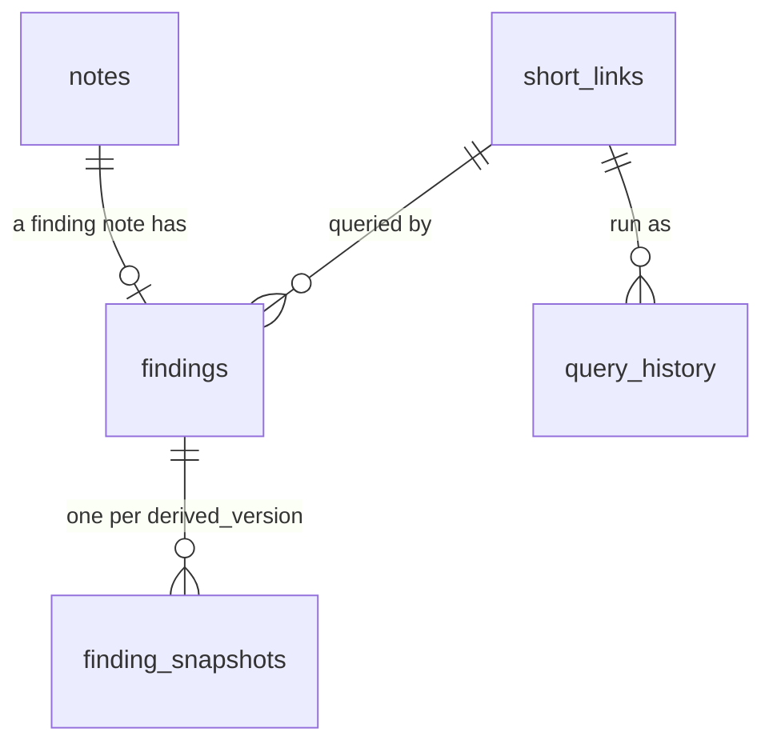

# Notes

This page describes what notes and findings store and how they're added and edited.

A note is text about one or more nights. It might record a procedure, a sleep study, or a new mask. A finding is a note that also stores the query it came from and that query's results, so you can check the conclusion again after the scoring rules change.

## Tables

Notes live in the `notes` Postgres schema, which is separate from the rebuildable `derived` schema. Only `@airway/contract/notes/schema` defines the tables, and it defines them with Drizzle.



| Table | One row per | Holds |
|---|---|---|
| `notes` | Note | Its nights, how precisely they're known, an optional time range, the category, a Markdown body, and who wrote and last edited it |
| `findings` | Finding note | The short code of the query that the finding came from |
| `finding_snapshots` | Finding and `derived_version` | The result rows, capped at 200 rows or 25,000 characters like agent results, and when the query ran |
| `short_links` | Short code | A canonical builder spec or a SQL statement |
| `query_history` | Explicit query run | The short code, who ran it and from where, when, the row count, and whether the result was truncated |

Deleting a note sets `deleted_at`. The note's rows, including a finding's rows in `finding_snapshots`, stay in the database, so the delete can be undone. airway never deletes query history.

An author is stored as three columns: the email and name from the verified identity, and the channel, which is `web` or `mcp`. The email and name are copied when the row is written, so a note shows the name that its author had at that time. An edit overwrites the note and records `updated_at` and the editor, so only the latest version is stored.

### Constraints

Text columns with a fixed set of values use CHECK constraints rather than Postgres enums, so adding a value is a one-line migration. The constraints also enforce:

- A note's dates match its precision. A month is stored as its 1st and a year as 1 January, so sorting and range filters work.
- The last night is on or after the first.
- Only a note dated to the day can have a time range, and the range has both ends, in order.
- A body has some text other than spaces, and at most 32,000 characters.
- `updated_at` and the editor are set together.
- A short link stores either a spec or SQL, and its kind says which of the two it stores.
- A finding references a note in the `finding` category. `findings` has its own `category` column, which is always `finding`, and the foreign key is on `(note_id, category)`. A finding note can't move to another category while its finding exists.

### Times and dates

Timestamps are `timestamptz` and nights are `date`. Drizzle's node-postgres driver sends its own type parsers with every query, and they return both types as text. They override the pool's parsers, so the pool's Temporal conversion never runs for Drizzle queries. `notes/columns.ts` defines two custom column types. One turns `timestamptz` text into a `Temporal.Instant`, and the other turns `date` text into a `Temporal.PlainDate`.

## Inputs

`@airway/contract/notes/api` defines the zod schemas that the note procedures and MCP's note tools accept as input. They're built from the tables with drizzle-zod, so a column's type is written once. The web app imports only their types, so Drizzle stays out of the browser bundle.

| Schema | Taken by |
|---|---|
| `AddNote` | `notes.add`, `add_note` |
| `UpdateNote` | `notes.update`: the note's ID plus the fields that change |
| `NoteId` | `notes.get`, `notes.delete`, `notes.restore`, `findings.get`, `findings.runNow` |
| `ListNotes` | `notes.list`, `list_notes`: an optional night range and category |
| `SaveFinding` | `save_finding`: a builder query's short code and the finding's text |
| `ListHistory` | `history.list`: a page of runs, newest first |
| `HistoryEntry` | The server, when it records a run |

The server sets the author from the request. An input that names an author fails validation. `AddNote` also refuses the `finding` category, because saving a finding is the only way to make a finding note.

A body needs some text other than spaces and is at most 32,000 characters. The schema counts characters the way Postgres counts them, so an emoji counts once.

Nights and times arrive as `Temporal` values, because tRPC's transformer rebuilds them on the server. The database checks a note's dates against its precision and against each other, so the input schemas skip those checks.

A finding re-runs its query after a scoring change, so the query has to give its nights as dates. `findingNights(spec)` returns the spec's first and last night, and the finding's note shows them. For a relative range like `{last: 14}`, it fails with `relative_nights`. MCP's `save_finding` converts such a range to dates before it saves.

## Migrations

`drizzle-kit generate` writes the SQL migrations from the schema into `packages/contract/drizzle/`. After changing `notes/schema.ts`, run it and commit the new migration with the change:

```sh
pnpm --filter @airway/contract migrations:generate --name <what-changed>
```

CI runs the same script in the step "Check the notes migrations are up to date". If the script creates a migration in CI, a schema change was committed without its migration, and the step fails.

A migration that changes stored notes is a breaking change, so mark its PR title with `!`.
