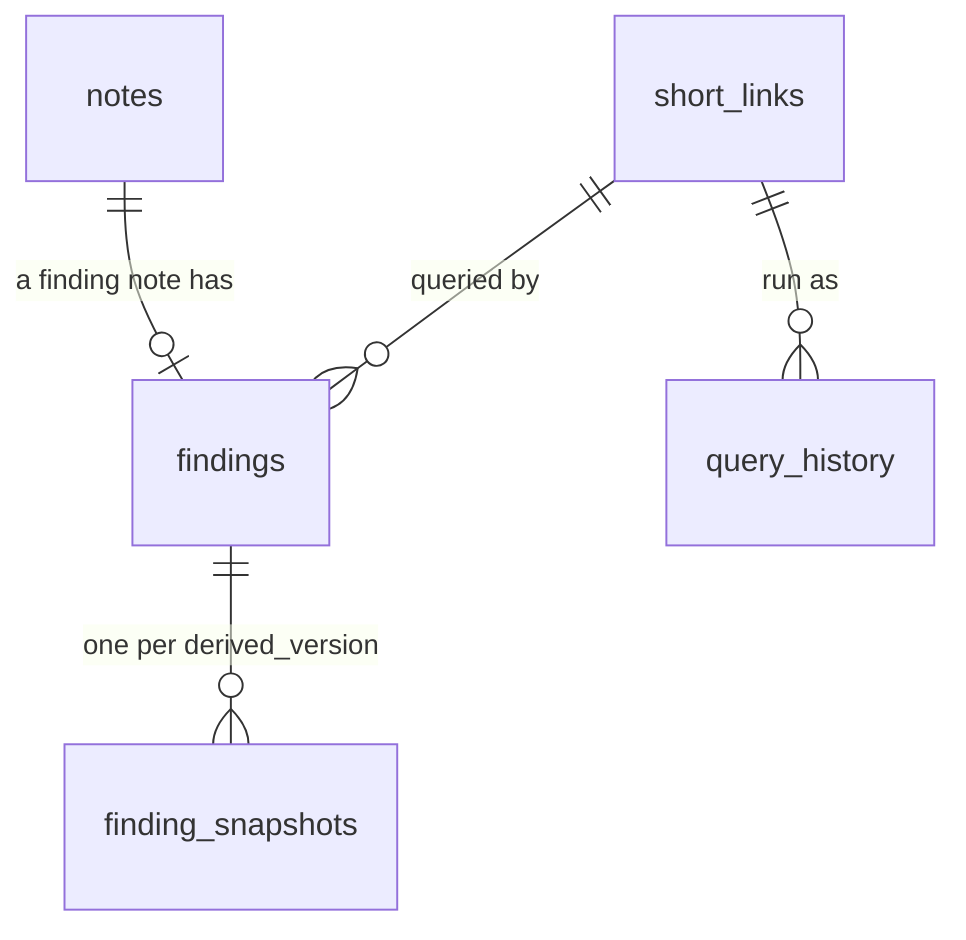

# Notes

Notes and findings: what they store, and how they're added and edited.

A note is something written about one or more nights, such as a procedure, a sleep study, or a new mask. A finding is a note that also keeps the query behind it and that query's results, so a conclusion can be checked again after the scoring rules change.

## Tables

Notes live in the `notes` Postgres schema, apart from the rebuildable `derived` schema. `@airway/contract/notes/schema` defines its tables in Drizzle, and that file is the only place they're defined.



| Table | One row per | Holds |
|---|---|---|
| `notes` | Note | Its nights, how precisely they're known, an optional time range, the category, a Markdown body, and who wrote and last edited it |
| `findings` | Finding note | The short code of the query behind it |
| `finding_snapshots` | Finding and `derived_version` | The result rows, at most 200 rows or 25,000 characters as agent results are, and when the query ran |
| `short_links` | Short code | A canonical builder spec or a SQL statement |
| `query_history` | Explicit query run | The short code, who ran it and from where, when, the row count, and whether the result was truncated |

Deleting a note sets `deleted_at`. Nothing is purged, so a delete can be undone, and a deleted finding keeps its snapshots. Query history is never pruned either.

An author is stored as three columns: the email and name from the verified identity, and the channel, `web` or `mcp`. They're copied when the row is written, so a note shows the name its author had then. An edit overwrites the note and records `updated_at` and the editor. There are no revisions.

### Constraints

Text columns with a fixed set of values use CHECK constraints rather than Postgres enums, so adding a value is a one-line migration. The constraints also enforce:

- A note's dates match its precision. A month is stored as its 1st and a year as 1 January, so sorting and range filters work.
- The last night isn't before the first.
- A time range has both ends, in order, and only on a note dated to the day.
- A body has some text other than spaces, and at most 32,000 characters.
- `updated_at` and the editor are set together.
- A short link holds a spec or SQL, whichever its kind names, and never both.
- A finding points at a note in the `finding` category. `findings` has its own `category` column, always `finding`, and the foreign key is on `(note_id, category)`. A finding note can't move to another category while its finding exists.

### Times and dates

Timestamps are `timestamptz` and nights are `date`. Drizzle's node-postgres driver sends its own type parsers with every query, and they return both types as text. They override the pool's parsers, so the pool's Temporal conversion never runs for Drizzle queries. `notes/columns.ts` has two custom column types that turn the text into a `Temporal.Instant` and a `Temporal.PlainDate`.

## Migrations

`drizzle-kit generate` writes the SQL migrations from the schema into `packages/contract/drizzle/`. After changing `notes/schema.ts`, run it and commit the new migration with the change:

```sh
pnpm --filter @airway/contract migrations:generate --name <what-changed>
```

CI runs the same script in the step "Check the notes migrations are up to date". If the script creates a migration there, the schema changed without one, and the step fails.

A migration that changes stored notes is a breaking change, so its PR title carries a `!`.
