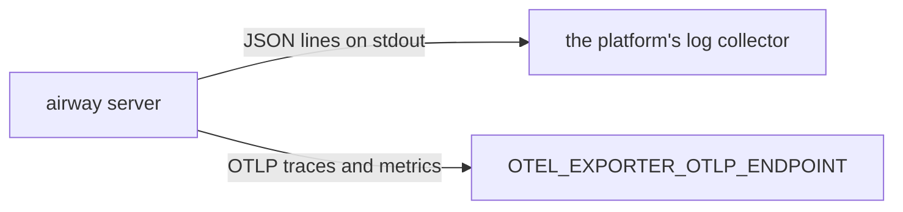

# Observability

The server writes logs to stdout and sends traces and metrics to an OTLP endpoint. Where they go from there is up to the deployment. Logs carry the trace and span IDs, so a log line links to its trace.



## Logs

The server logs JSON lines to stdout with pino, through the root logger from `packages/server/src/logger.ts`. Each line includes `service: "airway"` and writes its level as a name, such as `"info"`, so log queries can filter on the level. `LOG_LEVEL` sets the lowest level logged. A line written inside a span also carries `trace_id` and `span_id`. When a logged `error` has a `cause` that is an `Error`, the logger writes the cause with its type, code, message, and stack.

Each module logs through a child logger bound to the module's name, such as `ctx.logger.child({ module: "http" })`. The module adds the IDs of the work it's doing.

`pnpm dev` prints the server's logs through pino-pretty; production logs stay JSON.

## Errors

A function that can fail returns a `Result`, and each service module has one error union of tagged objects, such as `{ kind: "not_found" }`.

- **The code that returns an `Err` logs it** through the module's child logger, and chooses the level. A routine outcome, such as a night with no data, can go unlogged.
- **Boundaries turn the `Err` into a response and leave the logging to the code that returned it.** The boundaries are tRPC procedures, MCP tools, and middleware.
- **Thrown errors are bugs.** The HTTP app's error handler logs them.

## Telemetry startup

`packages/server/src/instrument.ts` starts the OpenTelemetry SDK. Production loads it before the server with `node --import ./dist/instrument.js dist/main.js`, and `pnpm dev` passes the source file to `--import`. Instrumentation is then in place before any dependency loads.

The SDK starts only when `OTEL_EXPORTER_OTLP_ENDPOINT` is set. It reads the standard `OTEL_*` variables itself. airway sets two defaults. OTLP logs are off, because logs go to stdout. Propagators are off, so airway ignores an inbound `traceparent` header and starts its own trace.

Every span and metric carries `service.name` `airway`, `service.version` from `AIRWAY_VERSION`, and `vcs.ref.head.revision` from `AIRWAY_GIT_SHA`. The image sets both variables, and both default to `dev` outside the image. Attributes in a deployment's `OTEL_RESOURCE_ATTRIBUTES` take precedence. The SDK flushes when the event loop empties, which happens after `main.ts` has closed everything at shutdown.

## Traces

Inbound HTTP requests get a span each, except kubelet probes (`/healthz`). Every span's `url.query` is blanked, because query strings are noisy and don't help debugging.

The instrumentation records a client span for each Postgres query and for each connection taken from a pool. The query's span records the SQL text, which `libpg-query` normalizes the way `pg_stat_statements` does: every literal becomes `$1`, `$2`, and so on. You can find a slow query by its text. The values in SQL that a person types into the SQL view, or that an agent sends, are replaced before the text is recorded. SQL that doesn't parse is recorded blank. Bound values are never recorded.

```
typed:     select night, ahi from nights where ahi > 5
recorded:  select night, ahi from nights where ahi > $1
```

Services add their own spans with `inSpan` and `inSpanAsync` from `packages/server/src/telemetry.ts`:

```ts
import { inSpanAsync } from "../telemetry.ts";

function loadNight(ctx: AppContext, night: Temporal.PlainDate): ResultAsync<Night, NightsError> {
  return inSpanAsync("nights.load", (span) => {
    span.setAttribute("airway.night", night.toString());

    return readNight(ctx, night);
  });
}
```

- An `Ok`, or a plain value from `inSpan`, ends the span and leaves its status unset. Pure work, such as planning a night's segments, can therefore return its value directly.
- An `Err` sets the span's status to error and records its `kind` as `error.type`.
- A throw sets the status to error, records the exception (its message and stack) with its class as `error.type`, and rethrows.

The helpers never log; see [Errors](#errors). `untraced(fn)` turns tracing off inside `fn`, for idle polls that would otherwise send empty traces.

### Sampling ingest traces

Ingest polls the CPAP data folder every 5 minutes, and every poll sends a trace, idle ones included. An idle poll's trace holds the scan and readiness spans. The first poll after a restart reads every header and hashes every file, so its trace has a span per file. A long history makes that thousands of spans.

Sample those traces in your collector with tail sampling, which keeps or drops each trace whole. Keep every poll that planned nights or failed, and a share of idle ones.

## Metrics

The SDK exports metrics every 60 seconds. Histograms are exponential, so their buckets adapt to the recorded values and instruments leave bucket boundaries unset. Built-in metrics come from the instrumentations:

- `http.server.request.duration` for inbound requests, except probes
- `db.client.operation.duration` for queries, and each pool's connection counts
- `rpc.server.call.duration` for each tRPC procedure, by procedure and error type ([Server](server.md#trpc))
- the Node runtime's event loop delay and utilization, heap, and GC

airway's own metrics are named `airway.<area>.<name>`, such as `airway.ingest.last_success`, with [semconv units](https://opentelemetry.io/docs/specs/semconv/general/metrics/#instrument-units) (`s`, `By`, `{night}`). Their attributes never carry values from the data, because each distinct value starts a new time series.

A module creates its instruments when its service is built, not when the module loads:

```ts
export class IngestMetrics {
  // The metrics API has no proxy, so a meter taken before the SDK starts stays a no-op.
  readonly #meter = metrics.getMeter("airway/ingest");
  readonly #lastSuccess = this.#meter.createGauge("airway.ingest.last_success", { unit: "s" });
}
```
