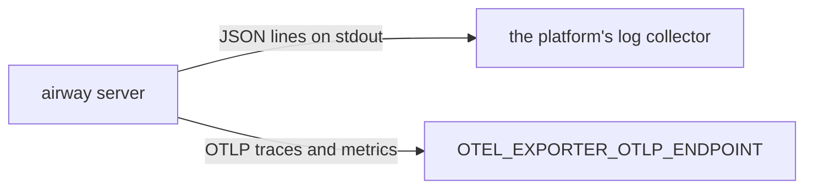

# Observability

The server writes logs to stdout and sends traces and metrics to an OTLP endpoint. Where they go from there is up to the deployment. Logs carry the trace and span IDs, so a log line links to its trace.



## Logs

The server logs JSON lines to stdout with pino, through the root logger from `packages/server/src/logger.ts`. Each line carries `service: "airway"` and its level as a name, such as `"info"`, so log queries can filter on it. `LOG_LEVEL` sets the lowest level logged. A line written inside a span also carries `trace_id` and `span_id`.

Each module logs through a child logger with its name bound, `ctx.logger.child({ module: "http" })`, and adds the IDs of the work it's doing.

Logs carry IDs, counts, and outcomes, never values from the data.

`pnpm dev` prints the server's logs through pino-pretty; production logs stay JSON.

## Errors

A function that can fail returns a `Result`, and each service module has one error union of tagged objects, such as `{ kind: "not_found" }`.

- **The code that returns an `Err` logs it**, through its child logger, at the level it chooses. A routine outcome, such as a night with no data, can go unlogged.
- **Boundaries don't log it again.** tRPC procedures, MCP tools, and middleware turn the `Err` into a response.
- **Thrown errors are bugs.** The HTTP app's error handler logs them.

## Telemetry startup

`packages/server/src/instrument.ts` starts the OpenTelemetry SDK. Production loads it before the server with `node --import ./dist/instrument.js dist/main.js`, and `pnpm dev` does the same with the source file, so instrumentation is in place before any dependency loads.

The SDK starts only when `OTEL_EXPORTER_OTLP_ENDPOINT` is set. It reads the standard `OTEL_*` variables itself. airway sets two defaults: no OTLP logs (logs go to stdout) and no propagators, so a `traceparent` header from outside never joins airway's traces. The SDK flushes when the event loop empties, which happens after `main.ts` has closed everything at shutdown.

## Traces

Inbound HTTP requests get a span each, except kubelet probes (`/healthz`). Every span's `url.query` is blanked, because the explorer's URL holds the user's query.

Services add their own spans with `inSpan` and `inSpanAsync` from `packages/server/src/telemetry.ts`:

```ts
import { inSpanAsync } from "../telemetry.ts";

function loadNight(ctx: AppContext, night: Temporal.PlainDate): ResultAsync<Night, NightsError> {
  return inSpanAsync("nights.load", (span) => {
    span.setAttribute("airway.night", night.toString());

    return readNight(ctx, night);
  });
}
```

- An `Ok` ends the span with no status.
- An `Err` sets the span's status to error and records its `kind` as `error.type`.
- A throw sets the status to error, records the error's class as `error.type`, and rethrows. The message isn't recorded, because it can hold data, such as a Postgres error's bound values.

The helpers never log; see [Errors](#errors). `untraced(fn)` turns tracing off inside `fn`, for idle polls that would otherwise send empty traces.

Span attributes follow the same rule as logs: IDs, counts, and outcomes, never values from the data.

## Metrics

The SDK exports metrics every 60 seconds. Histograms are exponential, so their buckets adapt to what's recorded and no instrument picks bucket boundaries. Built-in metrics come from the instrumentations:

- `http.server.request.duration` for inbound requests, without probes
- the Node runtime's event loop delay and utilization, heap, and GC

airway's own metrics are named `airway.<area>.<name>`, such as `airway.ingest.last_success`, with [semconv units](https://opentelemetry.io/docs/specs/semconv/general/metrics/#instrument-units) (`s`, `By`, `{night}`). Their attributes never carry values from the data.

A module creates its instruments when its service is built, not when the module loads:

```ts
export class IngestMetrics {
  // The metrics API has no proxy, so a meter taken before the SDK starts stays a no-op.
  readonly #meter = metrics.getMeter("airway/ingest");
  readonly #lastSuccess = this.#meter.createGauge("airway.ingest.last_success", { unit: "s" });
}
```
