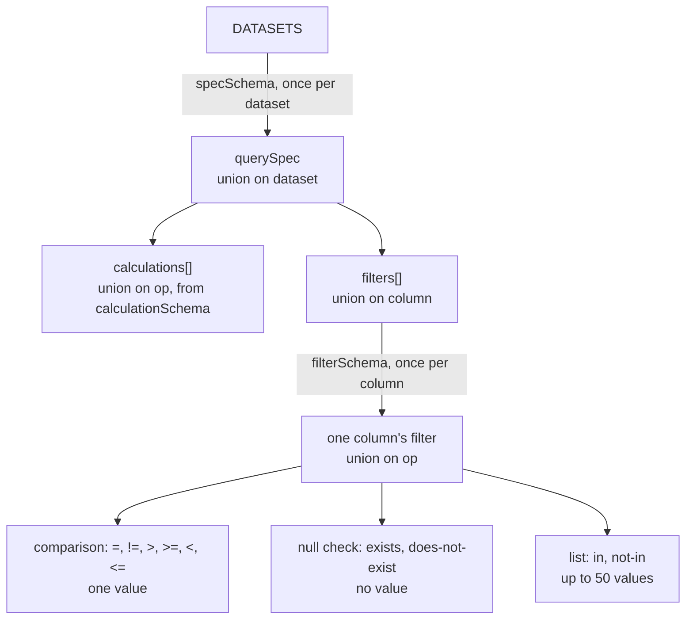

# Query

How builder queries are written and compiled to SQL, and how SQL runs read-only.

## The query spec

A builder query is a JSON object called the spec. The spec names one dataset, the rows to read from it, and what to compute over those rows. The explorer's links, the builder, and the agent tools all write the same spec, and `parseSpec` in `@airway/contract/query/spec` checks each spec they write.

The spec uses Honeycomb's field names and operation names, because agents already know how to write Honeycomb queries.

```json
{
  "v": 1,
  "dataset": "events",
  "nights": { "last": 30 },
  "calculations": [{ "op": "COUNT" }],
  "filters": [{ "column": "type", "op": "=", "value": "obstructive_apnea" }],
  "breakdowns": ["hour_of_night"],
  "granularity": "night"
}
```

| Field | Value | Default |
|---|---|---|
| `v` | `1`, the spec's version | required |
| `dataset` | `nights`, `sessions`, `events`, `samples`, or `breaths` | required |
| `nights` | `{"last": n}` for the most recent n nights, or `{"from", "to"}` with two dates | required |
| `calculations` | Up to 10 of `{op, column}` | `[{"op": "COUNT"}]` |
| `filters` | Up to 20 of `{column, op, value}` | none |
| `filter_combination` | `AND` or `OR`, for the whole list | `AND` |
| `breakdowns` | Up to 3 columns to group by | none |
| `orders` | `{op, column, order}` for a calculation, or `{column, order}` for a breakdown | none |
| `havings` | Up to 10 of `{calculate_op, column, op, value}`, which keep the groups whose total passes | none |
| `limit` | The most groups to return, up to 1,000 | 100 |
| `granularity` | The time step to bucket by, or `auto` | none: totals only |

`parseSpec` returns the spec with every default filled in, or a list of issues. Each issue has the path of the wrong field, such as `filters[0].op`, and a message that lists what's allowed there. An unknown field is an issue too, so a misspelled clause isn't silently dropped.

### What the registry decides

The schema is generated from the [registry](data-model.md#columns) with one variant per dataset, so a spec can name only the columns of its own dataset.

- **Calculations.** `COUNT` takes no column. `COUNT_DISTINCT` takes any column. `SUM`, `AVG`, and the percentiles (`P001` to `P999`) take a metric. `MIN` and `MAX` take any number, integer, timestamp, or date column, and return a value of the column's kind. `columnsFor(dataset, op)` lists the columns an operation takes.
- **Filters.** A column's kind decides which operations a filter on the column can use ([`operationsFor`](data-model.md#columns)) and what the filter's value must be: a number, an integer, a boolean, one of an enum's values, a date, or a time. A time must carry its offset, such as `2026-06-01T02:00:00-04:00`. `in` and `not-in` take a list of up to 50 values, and `exists` and `does-not-exist` are written without a value.
- **Breakdowns.** A breakdown can be any time or dimension column.
- **Granularity.** The step can be the dataset's grain or longer. `nights` allows `night`, `week`, and `month`. The other four also allow `2s`, `30s`, `1m`, `5m`, `15m`, and `1h`. Each step covers a limited range ([Range limits](#range-limits)).

Numbers in filters and havings are in display units: a leak filter is in L/min ([Units](data-model.md#units)).

### Range limits

A query covers at most 3,660 nights, about ten years, however its range is written. A finer step covers fewer nights, so `parseSpec` refuses a fine step over a long range before any SQL runs:

| Granularity | Most nights |
|---|---|
| `2s` | 1 |
| `30s` | 7 |
| `1m` | 14 |
| `5m` | 31 |
| `15m` | 92 |
| `1h` | 366 |
| `night`, `week`, `month` | 3,660 |

`auto` picks the finest step that the dataset and the range allow and that satisfies

```
nights × 86,400 ÷ step seconds ≤ 300
```

The left side is how many buckets one group would get if the machine ran around the clock. The 300 is `AUTO_BUCKETS`, which is about as many buckets as a chart can show. To move the boundaries below, change only `AUTO_BUCKETS`, because each boundary follows from it and from each step's length in `STEP_SECONDS`.

| Nights | `auto` picks | Buckets at most |
|---|---|---|
| 1 | `5m` | 288 |
| 2 to 3 | `15m` | 288 |
| 4 to 12 | `1h` | 288 |
| 13 to 300 | `night` | 300 |
| 301 to 2,100 | `week` | 300 |
| 2,101 to 3,660 | `month` | 122 |

The shortest step for `nights` is `night`, so `auto` picks `night` for any range up to 300 nights. `granularityOf(dataset, spec)` returns the step that `auto` picks. The step depends only on the spec.

Each limit keeps one group's series to about 10,000 to 20,000 buckets for a machine that runs around the clock, and to about a third of that for ordinary nights. When a range is too long for its step, the issue names the limit and lists the steps that the range allows. `granularitiesFor(dataset, nights)` gives the same list to the builder.

### What must agree within a spec

- A calculation, a breakdown, or an order appears once.
- An order names a calculation of the same spec by its `op` and `column`, or a breakdown by its `column`.
- A having names a calculation of the same spec, and the having's value is of the kind that the calculation returns: a time or a date for `MIN` or `MAX` of a time or date column, and a number for every other calculation.

A function in `spec.ts` checks each of these and returns the problems it finds. The functions run after every field has passed its own check.

### How the schema is built

The schema is three levels of nested unions, and `spec.ts` builds each level by mapping over the registry. zod picks a union's member by one field, called the discriminator, so zod reports a wrong value at the field that holds it.



`filterSchema(column)` takes the operations that `operationsFor` returns for the column and the value type of the column's kind, then sorts the operations into the three shapes. For example:

| Column | Comparison | Null check | List |
|---|---|---|---|
| `type` (enum) | `=`, `!=` with one event type | yes | `in`, `not-in` with event types |
| `duration` (number) | all six, with a number | yes | none |
| `outside_mask_on` (boolean) | `=`, `!=` with a boolean | yes | none |

`filterSchema` includes the list shape only for a column with list operations, because `z.discriminatedUnion` throws when an option's `op` enum is empty.

`calculationSchema(dataset)` is a union on `op` with four shapes, and each shape lists the columns that its operations take. `COUNT` is written without a column, `COUNT_DISTINCT` takes any column, `SUM`, `AVG`, and the percentiles take a metric, and `MIN` and `MAX` take a column whose values can be ordered.

So for `{"dataset": "events", "filters": [{"column": "type", "op": ">"}]}`, zod picks the `events` spec by `dataset`, the `type` filter by `column`, and then finds no shape for `>`. The issue is at `filters[0].op` and lists `=`, `!=`, `exists`, `does-not-exist`, `in`, and `not-in`.

### Generated specs

`@airway/contract/query/arbitrary` has two fast-check arbitraries built from the registry. `specInput` generates a valid spec as a caller would write it, with optional fields left out at random. `spec` generates a parsed spec, with every default filled in. Tests of any code that takes a spec use both.

## Canonical form

`canonicalize(spec)` in `@airway/contract/query/canonical` rewrites a spec into its canonical form, so two specs that ask for the same thing share a link and a short code:

- Keys come in a fixed order.
- A field equal to its default is left out. `filter_combination` is also left out when there are fewer than two filters.
- Each `in` and `not-in` list is sorted, without repeats.
- Each time is written in UTC, so `02:00:00-04:00` and `06:00:00Z` are the same text.
- A filter or having that appears twice in the spec is written once.

Calculations, filters, breakdowns, orders, and havings keep the order they were written in. The builder's rows and the charts appear in the same order.

`canonicalJson(spec)` returns the canonical spec as compact JSON. A canonical spec is itself a valid spec, and parsing it gives the same canonical form again. The canonical spec can differ from the spec as first written, because `canonicalize` may reorder a list or rewrite a time.

## Results

`@airway/contract/api/query` defines what a builder query returns.

```ts
type QueryResult = {
  columns: ResultColumn[]; // the breakdowns, then the calculations
  groups: Group[];         // one per combination of breakdown values
  series?: {               // only with a granularity
    granularity: Granularity;
    rows: SeriesRow[];
  };
  truncated: boolean;
};
```

- **Columns.** Each has a key (`b0`, `b1` for breakdowns, then `c0`, `c1` for calculations), a label such as `hour_of_night` or `P95(leak)`, a kind, and, for a metric, its display unit.
- **Groups.** Each has its rank in the query's order, one value per breakdown, and one total per calculation. A total covers the whole night range. A query with no breakdowns has one group.
- **Series.** The series has the step that the rows are bucketed by, and one row per group and time bucket. When the spec asked for `auto`, the step is the step that `auto` picked. Each row has the bucket's start, the group's rank, and one value per calculation. Rows are in group order, then time order. A bucket without any dataset rows is left out of the series. A bucket's start is an instant for steps under a night, and a date for `night` and longer steps.
- **Truncated.** `truncated` is true when there were more groups than the query's `limit`, or more than 10,000 series rows. The result leaves out the groups that were cut.

A value is a number, text, a boolean, an instant, a date, or null. Numbers are in display units.

A SQL statement's result (`@airway/contract/api/sql`) is a table: named columns, each with a kind, and at most 10,000 rows. SQL reads the tables directly, so its numbers are in stored units.
