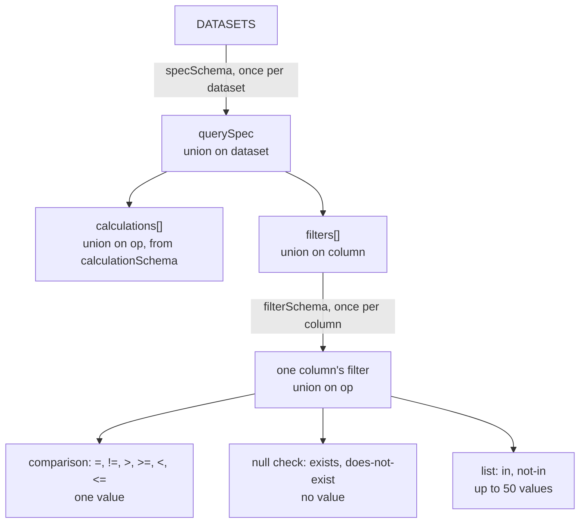

# Query

How builder queries are written and compiled to SQL, and how SQL runs read-only.

## The query spec

A builder query is a JSON object, the spec. It says what to compute over which rows of one dataset. The explorer's links, the builder, and the agent tools all write the same spec, and `parseSpec` in `@airway/contract/query/spec` checks every one.

The field names and operation names are Honeycomb's, because agents already write that shape.

```json
{
  "v": 1,
  "dataset": "events",
  "nights": { "last": 30 },
  "calculations": [{ "op": "COUNT" }],
  "filters": [{ "column": "type", "op": "=", "value": "obstructive_apnea" }],
  "breakdowns": ["hour_of_night"],
  "granularity": "night"
}
```

| Field | Value | Default |
|---|---|---|
| `v` | `1`, the spec's version | required |
| `dataset` | `nights`, `sessions`, `events`, `samples`, or `breaths` | required |
| `nights` | `{"last": n}` for the most recent n nights, or `{"from", "to"}` with two dates | required |
| `calculations` | Up to 10 of `{op, column}` | `[{"op": "COUNT"}]` |
| `filters` | Up to 20 of `{column, op, value}` | none |
| `filter_combination` | `AND` or `OR`, for the whole list | `AND` |
| `breakdowns` | Up to 3 columns to group by | none |
| `orders` | `{op, column, order}` for a calculation, or `{column, order}` for a breakdown | none |
| `havings` | Up to 10 of `{calculate_op, column, op, value}`, which keep the groups whose total passes | none |
| `limit` | The most groups to return, up to 1,000 | 100 |
| `granularity` | The time step to bucket by, or `auto` | none: totals only |

`parseSpec` returns the spec with every default filled in, or a list of issues. Each issue has the path of the wrong field, such as `filters[0].op`, and a message that lists what's allowed there. An unknown field is an issue too, so a misspelled clause isn't silently dropped.

### What the registry decides

The schema is generated from the [registry](data-model.md#columns), one variant per dataset, so a spec can only name that dataset's columns.

- **Calculations.** `COUNT` takes no column. `COUNT_DISTINCT` takes any column. `SUM`, `AVG`, and the percentiles (`P001` to `P999`) take a metric. `MIN` and `MAX` take any number, integer, timestamp, or date column, and give a value of that kind. `columnsFor(dataset, op)` lists the columns an operation takes.
- **Filters.** Each column allows the operations of its kind ([`operationsFor`](data-model.md#columns)), with values of its kind: a number, an integer, a boolean, one of an enum's values, a date, or a time. A time must carry its offset, such as `2026-06-01T02:00:00-04:00`. `in` and `not-in` take a list of up to 50 values, and `exists` and `does-not-exist` take none.
- **Breakdowns.** Any time or dimension column.
- **Granularity.** The dataset's grain or longer. `nights` allows `night`, `week`, and `month`. The other four also allow `2s`, `30s`, `1m`, `5m`, `15m`, and `1h`. Each step covers a limited range ([Range limits](#range-limits)).

Numbers in filters and havings are in display units: a leak filter is in L/min ([Units](data-model.md#units)).

### Range limits

A query covers at most 3,660 nights, about ten years, however its range is written. A finer step covers fewer, so a fine step over a long range is refused before anything runs:

| Granularity | Most nights |
|---|---|
| `2s` | 1 |
| `30s` | 7 |
| `1m` | 14 |
| `5m` | 31 |
| `15m` | 92 |
| `1h` | 366 |
| `night`, `week`, `month` | 3,660 |

`auto` picks the finest step the dataset and the range allow that satisfies

```
nights × 86,400 ÷ step seconds ≤ 300
```

The left side is how many buckets one group gets if the machine ran around the clock. 300 is `AUTO_BUCKETS`, about what a chart can show, and it's the only number to change: every boundary below follows from it and from each step's length in `STEP_SECONDS`.

| Nights | `auto` picks | Buckets at most |
|---|---|---|
| 1 | `5m` | 288 |
| 2 to 3 | `15m` | 288 |
| 4 to 12 | `1h` | 288 |
| 13 to 300 | `night` | 300 |
| 301 to 2,100 | `week` | 300 |
| 2,101 to 3,660 | `month` | 122 |

`nights` has no step under a night, so it gets `night` up to 300 nights. The pick depends only on the spec, so a link's step never changes under it, and `granularityOf(dataset, spec)` returns it.

Each limit keeps one group's series to about 10,000 to 20,000 buckets if the machine ran around the clock, and about a third of that on an ordinary night. The issue names the limit and lists the steps the range does allow. `granularitiesFor(dataset, nights)` gives the same list to the builder.

### What must agree within a spec

- A calculation, a breakdown, or an order appears once.
- An order names a calculation of the same spec by its `op` and `column`, or a breakdown by its `column`.
- A having names a calculation of the same spec, and its value fits what the calculation gives: a number, or a time or date for `MIN` and `MAX` of one.

Each of these is a function in `spec.ts` that returns the problems it finds, and they run after every field has passed its own check.

### How the schema is built

The schema is unions nested three deep, and each level is built by mapping over the registry. zod picks a union's member by one field, called the discriminator, so a wrong value is reported at the field where it's wrong.



`filterSchema(column)` starts from the operations `operationsFor` gives the column and the value type its kind gives, then sorts the operations into the three shapes. For example:

| Column | Comparison | Null check | List |
|---|---|---|---|
| `type` (enum) | `=`, `!=` with one event type | yes | `in`, `not-in` with event types |
| `duration` (number) | all six, with a number | yes | none |
| `outside_mask_on` (boolean) | `=`, `!=` with a boolean | yes | none |

A column with no list operations gets no list shape, because zod rejects a shape with no operations.

`calculationSchema(dataset)` has four shapes on `op`, each listing the columns its operations take: `COUNT` takes none, `COUNT_DISTINCT` takes any, `SUM`, `AVG`, and the percentiles take a metric, and `MIN` and `MAX` take a column with an order.

So for `{"dataset": "events", "filters": [{"column": "type", "op": ">"}]}`, zod picks the `events` spec by `dataset`, the `type` filter by `column`, and then finds no shape for `>`. The issue is at `filters[0].op` and lists `=`, `!=`, `exists`, `does-not-exist`, `in`, and `not-in`.

### Generated specs

`@airway/contract/query/arbitrary` has two fast-check arbitraries built from the registry: `specInput`, a valid spec as written with optional fields left out at random, and `spec`, the same after parsing. Tests of anything that takes a spec use them.

## Canonical form

`canonicalize(spec)` in `@airway/contract/query/canonical` gives a query its one spelling, so two specs that ask the same thing share a link and a short code:

- Keys come in a fixed order.
- Anything equal to its default is left out, and so is `filter_combination` when there are fewer than two filters.
- Each `in` and `not-in` list is sorted, without repeats.
- Each time is written in UTC, so `02:00:00-04:00` and `06:00:00Z` are the same text.
- A filter or having written twice is written once.

Calculations, filters, breakdowns, orders, and havings keep the order they were written in. That order is the order of the builder's rows and of the charts.

`canonicalJson(spec)` is the canonical spec as compact JSON. A canonical spec is itself a valid spec, and parsing it gives the same canonical form again. It isn't always the spec as first written: a list may be reordered and a time rewritten.

## Results

`@airway/contract/api/query` defines what a builder query returns.

```ts
type QueryResult = {
  columns: ResultColumn[]; // the breakdowns, then the calculations
  groups: Group[];         // one per combination of breakdown values
  series?: {               // only with a granularity
    granularity: Granularity;
    rows: SeriesRow[];
  };
  truncated: boolean;
};
```

- **Columns.** Each has a key (`b0`, `b1` for breakdowns, then `c0`, `c1` for calculations), a label such as `hour_of_night` or `P95(leak)`, a kind, and a metric's display unit.
- **Groups.** Each has its rank in the query's order, one value per breakdown, and one total per calculation. A total covers the whole night range. A query with no breakdowns has one group.
- **Series.** The step the rows are bucketed by, which is the one `auto` picked when the spec asked for `auto`, and one row per group and time bucket: the bucket's start, the group's rank, and one value per calculation. Rows are in group order, then time order. A bucket with no rows has no series row. A bucket's start is an instant for steps under a night, and a date from `night` up.
- **Truncated.** True when there were more groups than the query's `limit`, or more series rows than 10,000. Nothing stands in for the groups that were cut.

A value is a number, text, a boolean, an instant, a date, or null. Numbers are in display units.

A SQL statement's result (`@airway/contract/api/sql`) is a table: named columns, each with a kind, and at most 10,000 rows. SQL reads the tables directly, so its numbers are in stored units.
