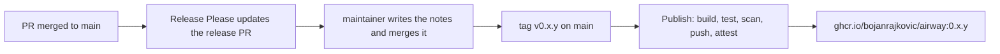

# Release

How airway is versioned, released, and published as an image.



## Versions

airway has one version, kept in the root `package.json` and every package's `package.json`. [Release Please](https://github.com/googleapis/release-please) works it out from the Conventional Commit titles merged to `main` since the last tag. Before 1.0, a `feat` bumps the patch version and a breaking change (`!`) bumps the minor version. `fix` bumps the patch version. Other types, such as `chore`, `ci`, and `docs`, don't cut a release on their own; they ship with the next one.

A change that raises `derived_version` or migrates the notes schema is breaking, so its title carries `!`. Its release notes say what happens to the data.

## Release PRs

`.github/workflows/release.yml` runs Release Please on every push to `main`. It keeps one release PR open with the next version and the generated notes. It runs with the releaser GitHub App's token, from the `release` environment, which only `main` can use. A PR or tag made with the workflow's own token wouldn't start CI.

Release PRs don't merge on their own. To release:

1. Run the `release-notes` skill. It drafts plain-language notes from the PRs since the last tag, shows them to you, and writes them into the release PR.
2. Merge the release PR. Release Please tags the merge commit `v<version>` and creates the GitHub release from the PR's notes.

There's no `CHANGELOG.md`; the GitHub releases are the changelog.

## Publishing

The tag starts `.github/workflows/publish.yml`. It builds the image once, without any cache, so nothing an earlier run wrote can reach a release. It runs the image tests and the Grype scan on that build, then pushes it to `ghcr.io/bojanrajkovic/airway:<version>` and attaches signed [build provenance](https://docs.github.com/en/actions/security-for-github-actions/using-artifact-attestations). It's the only job with write access to packages. Only releases are published.

The first publish creates the package as private. Make it public once, in the package's settings on GitHub; the cluster pulls it without credentials.

To check where an image came from:

```sh
gh attestation verify oci://ghcr.io/bojanrajkovic/airway:0.1.0 --repo bojanrajkovic/airway
```

It fails unless this repo's Publish workflow built that exact digest.

## The image

The `Dockerfile` builds the image in two stages.

1. **Build**, on `node:26-slim`: `pnpm fetch` downloads every package from the lockfile alone, so a source change reuses that layer. Then an offline install, `pnpm build`, and `pnpm deploy --prod`, which copies the server with only its production dependencies into a plain folder. The `@airway/*` packages are bundled into the server, and the web build sits in its `dist/public/`.
2. **Runtime**, on distroless `nodejs26-debian13:nonroot`: Node and its libraries, with no shell or package manager. It runs as UID 65532 and starts the server with `node --import ./dist/instrument.js dist/main.js`.

Both base images are pinned by digest, and Renovate updates the digests. The runtime image's name holds the Node major, so a new major means renaming it by hand. The pnpm version in the Dockerfile matches `mise.toml`, and Renovate updates both in one PR. The image is built for `linux/amd64` only; [#77](https://github.com/bojanrajkovic/airway/issues/77) adds arm64.

The build args `VERSION` and `GIT_SHA` become `AIRWAY_VERSION` and `AIRWAY_GIT_SHA`, which telemetry reports ([Observability](observability.md#telemetry-startup)).

Every PR builds the image and runs the image tests against it ([Testing](testing.md#image-tests)). Grype then scans it, and a high or critical finding that has a fix fails the build. A finding with no fix yet doesn't, because nothing in airway could act on it.
