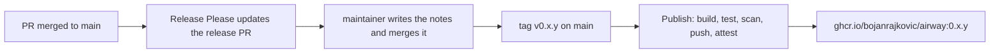

# Release

This page describes how airway is versioned, released, and published as an image.



## Versions

airway has one version, kept in the root `package.json` and every package's `package.json`. [Release Please](https://github.com/googleapis/release-please) works it out from the Conventional Commit titles merged to `main` since the last tag. Before 1.0, a `feat` bumps the patch version and a breaking change (`!`) bumps the minor version. `fix` bumps the patch version. Other types, such as `chore`, `ci`, and `docs`, don't cut a release on their own; they ship with the next one.

A change that raises `derived_version` or migrates the notes schema is breaking, so its title carries `!`. Its release notes say what happens to the data.

## Release PRs

`.github/workflows/release.yml` runs Release Please on every push to `main`. It keeps one release PR open with the next version and the generated notes. It uses the releaser GitHub App's token, because a PR or tag made with the workflow's own token wouldn't start CI. The App's token comes from the `release` environment, which only `main` can use.

A maintainer merges each release PR by hand. To release:

1. Run the `release-notes` skill. It drafts plain-language notes from the PRs since the last tag, shows them to you, and writes them into the release PR.
2. Merge the release PR. Release Please tags the merge commit `v<version>` and creates the GitHub release from the PR's notes.

The GitHub releases serve as the changelog, in place of a `CHANGELOG.md` file.

## Publishing

The tag starts `.github/workflows/publish.yml`. It builds the image once with the build cache disabled, so every layer in the release image comes from this build. It runs the image tests and the Grype scan on that build, then pushes it to `ghcr.io/bojanrajkovic/airway:<version>` and attaches signed [build provenance](https://docs.github.com/en/actions/security-for-github-actions/using-artifact-attestations). It's the only job with write access to packages. Only releases are published.

The first publish creates the package as private. Make it public once, in the package's settings on GitHub, so it can be pulled without credentials.

To check where an image came from:

```sh
gh attestation verify oci://ghcr.io/bojanrajkovic/airway:0.1.0 --repo bojanrajkovic/airway
```

The command succeeds only when this repo's Publish workflow built that exact digest.

## The image

The `Dockerfile` builds the image in two stages.

1. **Build**, on `node:26-slim`: `pnpm fetch` downloads every package from the lockfile alone, so Docker reuses that layer when only source files change. The stage then runs an offline install, `pnpm build`, and `pnpm deploy --prod`, which copies the server with only its production dependencies into a plain folder. The `@airway/*` packages are bundled into the server, and the web build sits in its `dist/public/`.
2. **Runtime**, on distroless `nodejs26-debian13:nonroot`: the base image contains only Node and its libraries, without a shell or a package manager. It runs as UID 65532 and starts the server with `node --import ./dist/instrument.js dist/main.js`.

Both base images are pinned by digest, and Renovate updates the digests. The runtime image's name includes the Node major version, so a maintainer changes the name by hand when Node's major version changes. The pnpm version in the Dockerfile matches `mise.toml`, and Renovate updates both in one PR. The image is built for `linux/amd64` only; [#77](https://github.com/bojanrajkovic/airway/issues/77) tracks arm64 support.

The build args `VERSION` and `GIT_SHA` become `AIRWAY_VERSION` and `AIRWAY_GIT_SHA`, which telemetry reports ([Observability](observability.md#telemetry-startup)).

Every PR builds the image and runs the image tests against it ([Testing](testing.md#image-tests)). Grype then scans it and fails the build on a high or critical vulnerability that has a fixed version. Grype ignores vulnerabilities without a fixed version, because no dependency update can resolve them yet.
