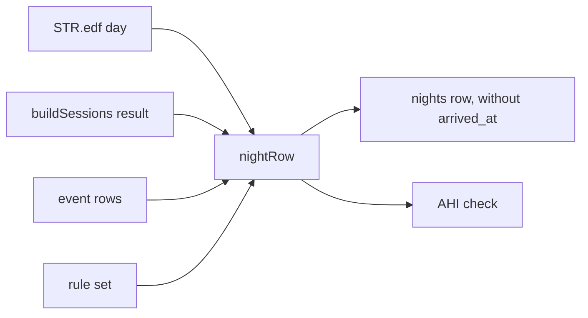

# Scoring

How airway computes and labels its numbers.

## Rule sets

The AASM (American Academy of Sleep Medicine) scores children and adults with different rules. `ruleSetFor(night, profile)` in `@airway/contract/profile` picks one per night from the patient's birth date:

- **pediatric** before the night of the 18th birthday, and **adult** from that night on;
- with `AIRWAY_ADULT_RULES_FROM_13=true`, adult from the night of the 13th birthday instead, as AASM allows for ages 13 to 17.

A 29 February birthday counts from 28 February in other years.

## Night rows

`nightRow({ day, sessions, events, ruleSet })` in `@airway/contract/derived/nights` builds a night's `nights` row from four inputs. `@airway/synthetic` calls it to build the rows it expects.

- `signals` holds the day's STR.edf values unchanged.
- `sessions` counts the night's sessions, and `expected_sessions` is half of STR.edf's `MaskEvents`. `session_count_approximate` copies the flag `buildSessions` sets when the two counts differ.
- `longest_stretch` is the longest session in minutes, or 0 on a night with no sessions.
- Each event type gets its own count, and `events_outside_mask_on` counts the events that fell outside every mask-on period.
- `ahi_check` is the outcome of [the AHI check](#the-ahi-check), and `rule_set` is the rule set `ruleSetFor` picks.

The caller adds `arrived_at`.

## The AHI check

The AHI (apnea-hypopnea index) is the number of apneas and hypopneas per hour of mask-on time. STR.edf stores the machine's AHI for each night to one decimal place. `ahiCheck(day, events)` recomputes it from the night's events and compares the two:

1. A night with no usage gives `no_usage`.
2. airway counts obstructive, central, and unclassified apneas and hypopneas, including those outside mask-on time. Arousals and unknown events don't count.
3. airway's index in tenths is `600 × events ÷ usage`, rounded down. STR.edf stores usage (`OnDuration`) in whole minutes, so the result is exact.
4. The machine's AHI is rounded to tenths to drop float noise. STR.edf stores it in 0.1 steps.
5. Equal values give `match`, and different values give `mismatch`, which flags the night. A used night with no machine AHI gives `mismatch`.

Floating point can land just under an exact result. 18 events in 400 minutes is exactly 27 tenths, but `18 / 400 × 60` in floating point is 2.6999…, which rounds down to 26 tenths.

The check returns both values on a mismatch, so ingest can log them.

## Why airway's numbers can differ from OSCAR's

airway shows the machine's own nightly numbers from STR.edf: usage, the AHI and its parts, and the leak and pressure percentiles. [OSCAR](https://www.sleepfiles.com/OSCAR/) (Open Source CPAP Analysis Reporter) recomputes them from the event and signal files, over sessions it builds itself. The two can round differently, split sessions differently, and count events differently, so a night can show different numbers in each.

## derived_version

Every change to how airway derives its tables raises `derived_version`, and gets an entry here: the version, what changed, and which numbers move.

| Version | What changed |
|---|---|
| 1 | The first tables: the machine's `STR.edf` statistics and events, sessions and segments, 2 s samples, and breaths. [Data model](data-model.md#derived-tables) lists them |
