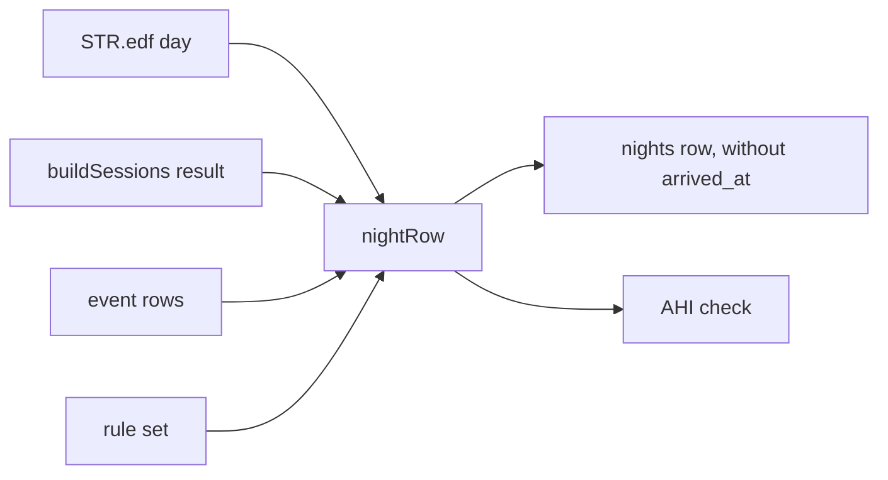

# Scoring

This page describes how airway computes and labels its numbers.

## Rule sets

The AASM (American Academy of Sleep Medicine) has different scoring rules for children and adults. `ruleSetFor(night, profile)` in `@airway/contract/profile` picks a rule set for each night from the patient's birth date:

- It picks **pediatric** before the night of the 18th birthday, and **adult** from that night on.
- With `AIRWAY_ADULT_RULES_FROM_13=true`, it picks **adult** from the night of the 13th birthday, as the AASM allows for ages 13 to 17.

In non-leap years, a 29 February birthday falls on 28 February.

## Night rows

`nightRow({ day, sessions, events, ruleSet })` in `@airway/contract/derived/nights` builds a night's `nights` row from four inputs. Ingest's `scoreNight` and `@airway/synthetic` both call it, so synthetic's expected rows and ingest's rows come from the same code.

- `signals` contains the day's STR.edf values unchanged.
- `sessions` is the number of sessions in the night, and `expected_sessions` is half of STR.edf's `MaskEvents`, rounded down. `session_count_approximate` is true when the session count differs from half of `MaskEvents`. It's always true when `MaskEvents` is odd.
- `longest_stretch` is the longest session in minutes, or 0 on a night with no sessions.
- `obstructive_apneas`, `central_apneas`, `unclassified_apneas`, `hypopneas`, and `arousals` count the events of each type. `events_outside_mask_on` counts the events that fall more than 60 s outside every session.
- `ahi_check` is the outcome of [the AHI (apnea-hypopnea index) check](#the-ahi-check), and `rule_set` is the rule set that the caller passes.

The caller adds `arrived_at`.

## The AHI check

The AHI is the number of apneas and hypopneas per hour of mask-on time. STR.edf stores the machine's AHI for each night to one decimal place. `ahiCheck(day, events)` computes airway's AHI from the night's events and compares it with the machine's:

1. For a night with no usage, the check returns `no_usage`.
2. airway counts hypopneas and obstructive, central, and unclassified apneas, including those outside mask-on time. It skips arousals and `other` events.
3. airway's index in tenths is `600 × events ÷ usage`, rounded down. STR.edf stores usage (`OnDuration`) in whole minutes, so both operands are integers.
4. STR.edf stores the machine's AHI in 0.1 steps, so airway rounds it to tenths to drop float noise.
5. The check returns `match` when the two values are equal. It returns `mismatch` when they differ or when STR.edf has no machine AHI.

Floating-point division can return a value just under the exact result. 18 events in 400 minutes is exactly 27 tenths, but `18 / 400 × 60` in floating point is 2.6999…, which rounds down to 26 tenths. Multiplying by 600 before dividing keeps the math in integers.

The check returns both values on a mismatch, so ingest can log them.

## Why airway's numbers can differ from OSCAR's

airway shows the machine's own nightly numbers from STR.edf: usage, the AHI and its parts, and the leak and pressure percentiles. [OSCAR](https://www.sleepfiles.com/OSCAR/) (Open Source CPAP Analysis Reporter) recomputes them from the event and signal files, over sessions it builds itself. The two can round differently, split sessions differently, and count events differently, so a night can show different numbers in each.

## derived_version

Every change to how airway derives its tables raises `derived_version`. The table below lists each version, what changed, and which numbers move.

| Version | What changed |
|---|---|
| 1 | The first tables: the machine's `STR.edf` statistics and events, sessions and segments, 2 s samples, and breaths. [Data model](data-model.md#derived-tables) lists them |
