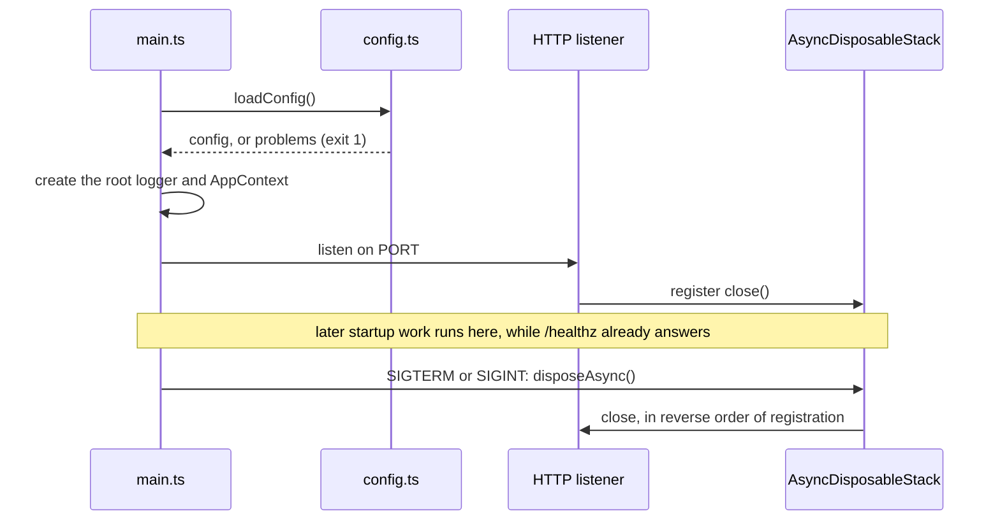

# Server

`packages/server` is one Node process: a Hono app that serves the API and the built web app. `src/main.ts` is the entry point, and Rolldown bundles it to `dist/main.js`.

## Startup and shutdown

The listener starts before anything else, so the pod answers `/healthz` while slower startup work runs. Everything that holds a resource registers its cleanup with one `AsyncDisposableStack`, and a signal closes them in reverse order.

## Shared dependencies

`src/runtime/context.ts` defines `AppContext`: the config, the root logger, and a clock. `main.ts` builds it once and passes it whole. A service takes the context plus its own arguments, and logs through `ctx.logger.child({ module })`. Tests build a context with `testContext()` from `tests/support/context.ts`, which has synthetic config, a silent logger, and a fixed clock.

## Routes

`createApp(ctx, { webRoot })` in `src/http/app.ts` builds the app:

- Every response carries the one Content-Security-Policy from `@airway/contract/csp`, including 404s and errors.
- `GET /healthz` answers `{"status":"ok"}`.
- `/assets/*` serves the web build's hashed files, and a missing one is a 404.
- Any other `GET` returns `index.html`, so a deep link such as `/explore?q=…` loads the web app, which reads the URL.
- An unhandled error logs and answers 500 without details.

Each lane that serves HTTP exports `routes(ctx): Hono` from its own folder, such as `src/mcp/routes.ts`, and `createApp` mounts it with `app.route(path, routes(ctx))`, before the deep-link fallback. A lane's middleware stays inside its own sub-app.

## The web build

`pnpm build` builds the web app into `packages/server/dist/public/`, next to the server bundle, where `main.ts` looks for it. With no build there, as in `pnpm dev`, the server serves only the API, and Vite serves the web app.

## Dependencies in the bundle

Packages in `packages/server/package.json`'s `dependencies` stay external and load from `node_modules`. Workspace packages, such as `@airway/contract`, are bundled.
