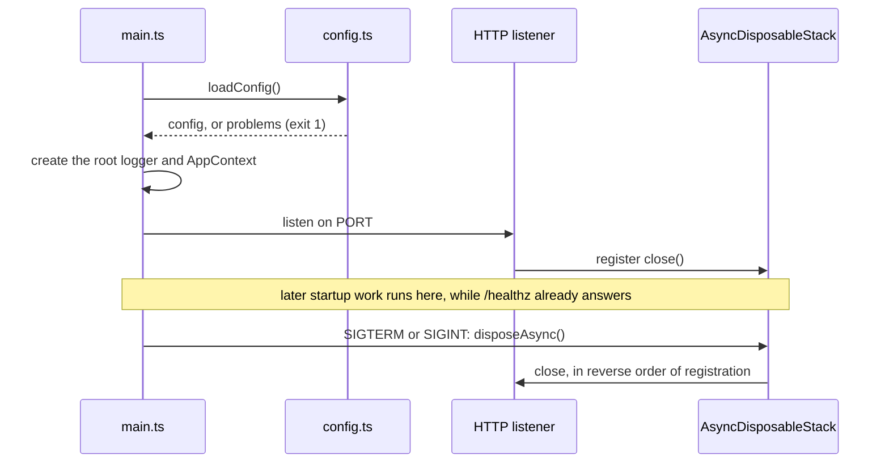

# Server

The server in `packages/server` is one Node process, a Hono app that serves the API and the built web app. `src/main.ts` is the entry point, and Rolldown bundles it to `dist/main.js`. Rolldown bundles the telemetry preload, `src/instrument.ts`, on its own to `dist/instrument.js`, and `node --import` runs the preload first ([Observability](observability.md#telemetry-startup)).

## Startup and shutdown



The listener starts before anything else, so the pod answers `/healthz` while slower startup work runs. Each component that holds a resource registers its cleanup with one `AsyncDisposableStack`. On SIGTERM or SIGINT, the stack runs the cleanups in reverse order of registration.

## Shared dependencies

`src/runtime/context.ts` defines `AppContext`: the config, the root logger, a clock, and the database pools. `main.ts` builds the context once and passes the whole context to the code that needs it. A service takes the context plus its own arguments, and logs through `ctx.logger.child({ module })`. Tests build a context with `testContext()` from `tests/support/context.ts`. That context has synthetic config, a silent logger, a fixed clock, and pools that connect only when a test queries them.

## Database pools

`createPools(config, logger)` in `src/db/pools.ts` opens three pools, and `main.ts` puts them on `ctx.db`:

| Pool | Role | Size | `statement_timeout` | Used for |
|---|---|---|---|---|
| `owner` | owner, through `DATABASE_URL` | 5 | none | every write, through Drizzle (`ctx.db.owner.db`) |
| `api` | reader, through `AIRWAY_READER_DATABASE_URL` | 5 | 10 s | the web API's queries |
| `agent` | reader, through `AIRWAY_READER_DATABASE_URL` | 3 | 15 s | agents' queries over MCP |

Each pool's connections appear in `pg_stat_activity` as `airway-<pool>`. The deployment sets the reader role's limits (read-only, `search_path`, `work_mem`, `temp_file_limit`) on the role itself, as [Operations](operations.md) describes.

Pools connect on their first query, so a server with no database still starts and answers `/healthz`. Shutdown closes the pools after the listener stops. When an idle connection drops, the pool logs the error code and opens a replacement on the next query.

Each pool parses three Postgres types into the types that airway uses:

- `timestamptz` to `Temporal.Instant`
- `date` to `Temporal.PlainDate`
- `int8`, such as `count(*)`, to `number`. The parser throws a `RangeError` for a value past 2^53, because `number` would round the value.

Each pool sets its own parsers and leaves pg's global `types` unchanged, so other pg clients in the process, such as the test database fixture, keep pg's defaults.

## Routes

`createApp(ctx, { webRoot })` in `src/http/app.ts` builds the app:

- `createApp` sets the Content-Security-Policy header from `@airway/contract/csp` on every response, including 404s and errors.
- `GET /healthz` answers `{"status":"ok"}`.
- `/assets/*` serves the web build's hashed files and returns 404 for a file that's missing.
- Any other `GET` returns `index.html`, so a deep link such as `/explore?q=…` loads the web app, which reads the URL.
- The `onError` handler logs an unhandled error and returns a plain-text 500 response without the error's details.

Each module that serves HTTP exports `routes(ctx): Hono` from its own folder, such as `src/mcp/routes.ts`. `createApp` mounts each module's routes with `app.route(path, routes(ctx))` before it adds the deep-link fallback. A module's middleware stays inside its own sub-app. The one exception is `requireAuthor`. `createApp` itself mounts `requireAuthor` on `/trpc/*` and `/mcp`, so every route under those paths runs it ([Auth](auth.md)).

## tRPC

The web app calls the server through tRPC, which `createApp` mounts at `/trpc` behind `requireAuthor` ([Auth](auth.md)). `src/trpc/router.ts` defines `appRouter`, and the web app imports its type, `AppRouter`, from `@airway/server/trpc` to get a typed client. `AppRouter` is only a type, so TypeScript erases the import when it compiles the web app.

tRPC serializes values with `transformer` from `@airway/contract/transformer`, which is superjson with `Temporal.Instant` and `Temporal.PlainDate` registered. A procedure can return a `Temporal.Instant` or a `Temporal.PlainDate`, and the client receives the same type. The client may send a query as a POST, because explorer queries can be too long for a URL.

Every procedure builds on `procedure` from `src/trpc/init.ts`. Its `ctx` has:

- `app`: the `AppContext`
- `author`: the caller, which `requireAuthor` identifies
- `signal`: a signal that aborts when the client disconnects
- `log`: a child logger bound to `module: "trpc"` and the procedure's path

A procedure is a controller: it parses input, calls a service, and maps the result. A service returns a `Result` with its own error union and never imports tRPC. `toTRPC(result, codeFor)` in `src/trpc/errors.ts` returns the `Ok` value, or throws a `TRPCError` with the code that `codeFor` returns for the error. Each service has one `codeFor` that covers its whole union, so the build fails on a new error case until `codeFor` maps that case:

```ts
const nightsCode = (error: NightsError): TRPC_ERROR_CODE_KEY => {
  switch (error.kind) {
    case "not_found":
      return "NOT_FOUND";
  }
};

export const nightsRouter = router({
  get: procedure
    .input(NightInput)
    .query(({ ctx, input }) => toTRPC(getNight(ctx.app, input.night), nightsCode)),
});
```

The `TRPCError` contains only the code. The service has already logged the failure ([Observability](observability.md#errors)), so the details stay on the server.

Each call runs in a span named `trpc.<path>` and records its duration on the `rpc.server.call.duration` histogram. The server sets `rpc.method` to the procedure's path on both the span and the histogram point. When a call fails, the span records the tRPC code as `error.type`. Only a code that maps to a 5xx marks the span as an error. The server keeps procedure inputs out of the span and the histogram.

### The procedure catalog

`@airway/contract/api/procedures` lists every procedure that the API will serve, each under its final name. The web app, MCP, and the query engine can build against a procedure before the server serves it.

- `PROCEDURES` maps each procedure to its kind and to the zod schema for its input, or to null for a procedure that's called without input. A run that records history is a mutation, because it writes a history entry. The web app imports only the catalog's types: the notes inputs are built from the Drizzle tables, so importing `PROCEDURES` as a value would put Drizzle in the browser bundle.
- `ProcedureOutputs` maps each procedure to the type that it returns. The catalog has only types for outputs, because the server sends a response without validating it again. The server's own types guarantee each output, and rows from Postgres are parsed where they're read.

| Area | Procedures |
|---|---|
| Queries | `query.run`, `query.tile`, `query.rows`, `sql.run`, `links.resolve`, `history.list` |
| Notes | `notes.list`, `notes.get`, `notes.add`, `notes.update`, `notes.delete`, `notes.restore`, `findings.get`, `findings.runNow` |
| Trends | `summary.lastNight`, `summary.range`, `summary.settingsChanges` |
| Waveforms | `waveform.window`, `waveform.night` |
| App | `app.status` |

MCP's `save_finding` calls the findings service directly, which is why the catalog omits `findings.save`.

`tests/trpc/procedures.test.ts` checks the router's types against the catalog, and `tsc --project tests` runs those checks. Every procedure that the router serves must have exactly the kind, input, and output of its catalog entry. An inferred return type fails that check when it's narrower than the catalog's type, such as `null` where the catalog says `string | null`. Annotate each handler's return type with the output type from the catalog. The test also lists the procedures that the router doesn't serve yet. A PR that adds a procedure to the router removes that procedure from the list.

## The web build

`pnpm build` builds the web app into `packages/server/dist/public/`, next to the server bundle, where `main.ts` looks for it. With no build there, as in `pnpm dev`, the server serves only the API, and Vite serves the web app.

## Dependencies in the bundle

Packages listed under `dependencies` in `packages/server/package.json` stay external, and Node loads them from `node_modules`. Rolldown bundles workspace packages, such as `@airway/contract`.
