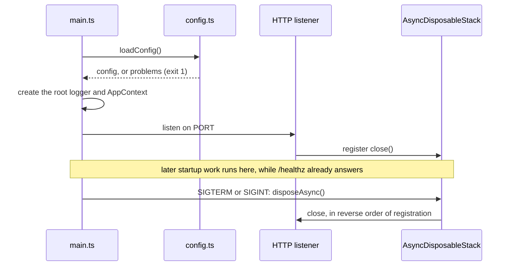

# Server

`packages/server` is one Node process: a Hono app that serves the API and the built web app. `src/main.ts` is the entry point, and Rolldown bundles it to `dist/main.js`. The telemetry preload, `src/instrument.ts`, is bundled on its own to `dist/instrument.js` and runs first, through `node --import` ([Observability](observability.md#telemetry-startup)).

## Startup and shutdown

The listener starts before anything else, so the pod answers `/healthz` while slower startup work runs. Everything that holds a resource registers its cleanup with one `AsyncDisposableStack`, and a signal closes them in reverse order.

## Shared dependencies

`src/runtime/context.ts` defines `AppContext`: the config, the root logger, a clock, and the database pools. `main.ts` builds it once and passes it whole. A service takes the context plus its own arguments, and logs through `ctx.logger.child({ module })`. Tests build a context with `testContext()` from `tests/support/context.ts`, which has synthetic config, a silent logger, a fixed clock, and pools that never connect unless a test queries them.

## Database pools

`createPools(config, logger)` in `src/db/pools.ts` opens three pools, and `main.ts` puts them on `ctx.db`:

| Pool | Role | Size | `statement_timeout` | Used for |
|---|---|---|---|---|
| `owner` | owner, through `DATABASE_URL` | 5 | none | every write, through Drizzle (`ctx.db.owner.db`) |
| `api` | reader, through `AIRWAY_READER_DATABASE_URL` | 5 | 10 s | the web API's queries |
| `agent` | reader, through `AIRWAY_READER_DATABASE_URL` | 3 | 15 s | agents' queries over MCP |

Each pool's connections show in `pg_stat_activity` as `airway-<pool>`. The reader role's own limits (read-only, `search_path`, `work_mem`, `temp_file_limit`) are set on the role by the deployment, as [Operations](operations.md) describes, not by the pools.

Pools connect on their first query, so a server with no database still starts and answers `/healthz`. Shutdown closes them after the listener stops. An idle connection that drops is logged with its error code and replaced on the next query.

Each pool parses three Postgres types into airway's own:

- `timestamptz` to `Temporal.Instant`
- `date` to `Temporal.PlainDate`
- `int8`, such as `count(*)`, to `number`. A value past 2^53 throws a `RangeError` instead of rounding.

The parsers are set per pool, not on pg's global `types`, so other pg clients in the process, such as the test database fixture, keep pg's defaults.

## Routes

`createApp(ctx, { webRoot })` in `src/http/app.ts` builds the app:

- Every response carries the one Content-Security-Policy from `@airway/contract/csp`, including 404s and errors.
- `GET /healthz` answers `{"status":"ok"}`.
- `/assets/*` serves the web build's hashed files, and a missing one is a 404.
- Any other `GET` returns `index.html`, so a deep link such as `/explore?q=…` loads the web app, which reads the URL.
- An unhandled error logs and answers 500 without details.

Each lane that serves HTTP exports `routes(ctx): Hono` from its own folder, such as `src/mcp/routes.ts`, and `createApp` mounts it with `app.route(path, routes(ctx))`, before the deep-link fallback. A lane's middleware stays inside its own sub-app. The one exception is `requireAuthor`, which `createApp` mounts on `/trpc/*` and `/mcp` itself, so no lane can forget it ([Auth](auth.md)).

## The web build

`pnpm build` builds the web app into `packages/server/dist/public/`, next to the server bundle, where `main.ts` looks for it. With no build there, as in `pnpm dev`, the server serves only the API, and Vite serves the web app.

## Dependencies in the bundle

Packages in `packages/server/package.json`'s `dependencies` stay external and load from `node_modules`. Workspace packages, such as `@airway/contract`, are bundled.
