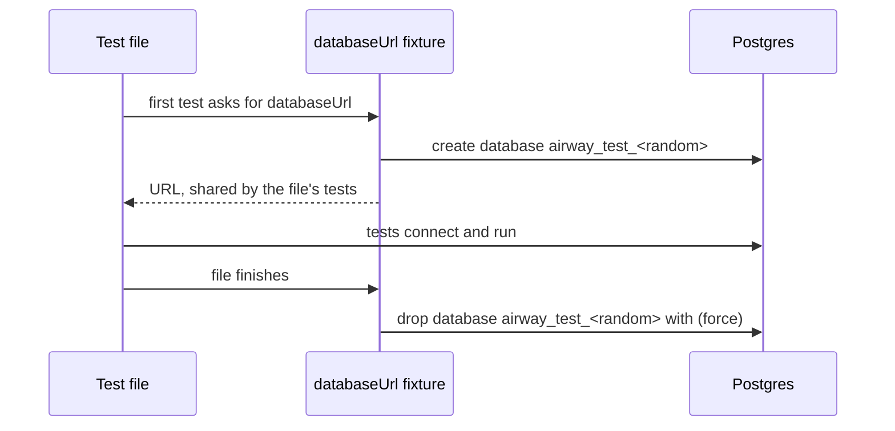

# Testing

Tests go where logic can be wrong: parsing, scoring, time math, the SQL path, permissions, and data writes. Don't test trivial wiring, such as "this file exists" or "this route is registered". Every test uses synthetic data; real CPAP data never goes in the repo.

## Running tests

Vitest runs four projects, all defined in `vitest.config.ts`:

| Project | Command | What it runs |
|---|---|---|
| `unit` | `pnpm test` (also part of `pnpm check`) | Every `*.test.ts` and `*.test.tsx` except telemetry, database, and browser tests |
| `telemetry` | `pnpm test` (also part of `pnpm check`) | Every `*.telemetry.test.ts`, each file isolated |
| `db` | `pnpm test:db` | Every `*.db.test.ts` and `*.db.test.tsx`, against a real Postgres |
| `browser` | `pnpm test:browser` | Every `*.browser.test.ts` and `*.browser.test.tsx`, in Chromium |
| `image` | `pnpm test:image` | Every `*.image.test.ts`, against a built image |

Vitest runs the files, and the tests inside each file, in a random order, so a test that needs another test to run first fails. A failing run prints its seed, and `pnpm test --sequence.seed=<seed>` replays that order.

To save time, the `unit` project shares one module registry across files instead of starting a fresh registry for each file. A test that sets up process-wide state, such as an OpenTelemetry SDK that registers global providers, would leak that state into other files. Such tests are named `*.telemetry.test.ts`, and the `telemetry` project runs each file with its own module registry.

## Telemetry tests

A telemetry test calls `inMemoryTelemetry()` from `@airway/testing/telemetry` at the top level of the file. `inMemoryTelemetry()` starts an OpenTelemetry SDK before the file's tests run, shuts the SDK down after the last test, and returns what the file's code recorded:

```ts
import { inMemoryTelemetry } from "@airway/testing/telemetry";

const { spans, metricReader, metricExporter } = inMemoryTelemetry();

it("records a span", () => {
  // spans.getFinishedSpans() holds every ended span; spans.reset() clears them.
  // metricReader.collect() reads metrics recorded since the last collect.
});
```

Pass `instrumentations` to test an instrumentation's settings, as `packages/server/tests/instrument.telemetry.test.ts` does for inbound HTTP.

## Where tests go

A package's tests live in its `tests/` folder and mirror `src/`: the tests for `src/query/compile.ts` go in `tests/query/compile.test.ts`. The `tests/` folder has its own `tsconfig.json`, so the Node types that the test helpers bring in never reach `src`. The repo's own tooling tests, such as the lint fixture test, live in the top-level `tests/`.

When more than one package's tests need a helper, it goes in `@airway/testing`, and tests import it as `@airway/testing/<file>`. A helper that only one package uses, such as the server's `testContext()` or the web's screenshot helper, stays in that package's `tests/support/`.

To build an instant from a clock time in the home time zone, use `instantAt(zone, date, time)` from `@airway/testing/time`. `instantAt("America/New_York", "2030-03-10", "15:00")` returns the instant when New York clocks read 15:00 that day, so a test gives the local time instead of working out the UTC offset by hand.

## Database tests

A database test is named `*.db.test.ts` and imports `test` from `@airway/testing/postgres` instead of from Vitest. That `test` adds two fixtures for an empty database that belongs to the test file:

- `databaseUrl` connects as `airway_owner`, which owns the database. `airway_owner` isn't a superuser, so a test that needs superuser rights fails.
- `readerUrl` connects to the same database as `airway_reader`, the read-only role the API and MCP use. The global setup turns on `default_transaction_read_only` for `airway_reader`, and sets its `search_path` to `derived`, its `work_mem` to 64MB, and its `temp_file_limit` to 1GB. It makes `airway_owner` a member of `airway_reader`, so the owner can cancel a reader's query.

Roles belong to the whole Postgres server, so the `db` project's global setup, `@airway/testing/roles`, creates both once per run. The setup also updates the roles' settings on each run, so it works against a Postgres server where the roles already exist.

```ts
import { expect } from "vitest";
import { test } from "@airway/testing/postgres";

test("writes a row", async ({ databaseUrl }) => {
  // Connect to databaseUrl. Its database is empty, and no other test file uses it.
});
```



The fixture drops the database with `force`, so the drop succeeds even when a test left a connection open.

### Postgres locally

`pnpm db:up` runs Postgres in Podman or Docker, published on `127.0.0.1:54318` with the password `airway`, and returns once it accepts connections. `pnpm db:down` stops the container and removes it along with its data. To use another server, set `AIRWAY_TEST_POSTGRES_URL` to a URL that connects to an existing database as a role that can create databases.

If the fixture can't connect within 3 seconds, it throws an `Error` that includes the Postgres host and has the `pg` connection error as its `cause`. The first database test fails with that error.

### Postgres in CI

The `Database tests` job runs the same image as a service container. The image is pinned by digest in two places, `scripts/db.sh` and `.github/workflows/ci.yml`, and both must name the same digest.

## Browser tests

A browser test is named `*.browser.test.tsx` and renders components in a real Chromium, through Vitest's browser mode and Playwright. Before the first run, install Chromium with `pnpm exec playwright install chromium`; CI runs in Playwright's image, which includes Chromium.

`takeScreenshots(name)` in `packages/web/tests/support/` saves desktop and phone shots in light and dark to `tests/__screenshots__/`. git ignores them; CI uploads them as the `screenshots` artifact for PR comments. Nothing compares them.

## Image tests

`tests/image.image.test.ts` starts the built image with [testcontainers](https://node.testcontainers.org) the way the pod runs it: read-only, as UID 65532, with a tmpfs `/tmp`. It checks that the server starts with only its production dependencies and serves the page, its script, and the CSP header. Everything else is tested against the source.

Build the image, then point `AIRWAY_IMAGE` at it:

```sh
docker build -t localhost/airway:dev .
AIRWAY_IMAGE=localhost/airway:dev pnpm test:image
```

If you use Podman, start its socket with `systemctl --user start podman.socket`, then also set `DOCKER_HOST=unix://$XDG_RUNTIME_DIR/podman/podman.sock` and `TESTCONTAINERS_RYUK_DISABLED=true`. Ryuk, the container that testcontainers uses to clean up, needs the Docker socket mounted, which rootless Podman doesn't allow.

## The lint fixture test

`tests/lint.test.ts` checks that the rules that its fixtures break still report. `tests/fixtures/lint/violations.ts` breaks the TypeScript rules, and `packages/web/tests/fixtures/lint/violations.tsx` breaks the React rules that Oxlint turns off by default. [Development](development.md#lint-and-format) explains why the test exists and how to update it.
