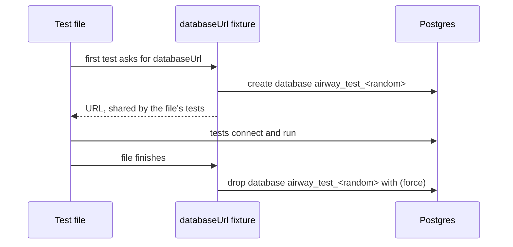

# Testing

Tests go where logic can be wrong: parsing, scoring, time math, the SQL path, permissions, and data writes. Trivial wiring, such as "this file exists" or "this route is registered", gets no test. Every test uses synthetic data; real CPAP data never goes in the repo.

## Running tests

Vitest runs four projects, all defined in `vitest.config.ts`:

| Project | Command | What it runs |
|---|---|---|
| `unit` | `pnpm test` (also part of `pnpm check`) | Every `*.test.ts` and `*.test.tsx` except telemetry, database, and browser tests |
| `telemetry` | `pnpm test` (also part of `pnpm check`) | Every `*.telemetry.test.ts`, each file isolated |
| `db` | `pnpm test:db` | Every `*.db.test.ts` and `*.db.test.tsx`, against a real Postgres 18 |
| `browser` | `pnpm test:browser` | Every `*.browser.test.ts` and `*.browser.test.tsx`, in Chromium |
| `image` | `pnpm test:image` | Every `*.image.test.ts`, against a built image |

Files, and the tests inside them, run in a random order, so a test that depends on another running first fails. A failing run prints its seed, and `pnpm test --sequence.seed=<seed>` replays that order.

The `unit` project shares one module registry across files, which saves starting a fresh one per file. A test that sets up process-wide state, such as starting an OpenTelemetry SDK that registers global providers, would leak that state into other files. Such tests are named `*.telemetry.test.ts`, and the `telemetry` project runs each file with its own module registry.

## Telemetry tests

A telemetry test calls `inMemoryTelemetry()` from `@airway/testing/telemetry` at the top level of the file. It starts an OpenTelemetry SDK before the file's tests and shuts it down after them, and returns what the file's code recorded:

```ts
import { inMemoryTelemetry } from "@airway/testing/telemetry";

const { spans, metricReader, metricExporter } = inMemoryTelemetry();

it("records a span", () => {
  // spans.getFinishedSpans() holds every ended span; spans.reset() clears them.
  // metricReader.collect() reads metrics recorded since the last collect.
});
```

Pass `instrumentations` to test an instrumentation's settings, as `packages/server/tests/instrument.telemetry.test.ts` does for inbound HTTP.

## Where tests go

A package's tests live in its `tests/` folder and mirror `src/`: the tests for `src/query/compile.ts` go in `tests/query/compile.test.ts`. The folder has its own `tsconfig.json`, so Node types that test helpers bring in never reach `src`. The repo's own tooling tests, such as the lint fixture test, live in the top-level `tests/`.

Helpers that more than one package's tests need go in `@airway/testing`, imported as `@airway/testing/<file>`. A helper only one package uses stays in that package's `tests/support/`, such as the server's `testContext()` and the web's screenshot helper.

## Database tests

A database test is named `*.db.test.ts` and imports `test` from `@airway/testing/postgres` instead of from Vitest. That `test` adds a `databaseUrl` fixture: the connection URL of an empty database that belongs to the test file.

```ts
import { expect } from "vitest";
import { test } from "@airway/testing/postgres";

test("writes a row", async ({ databaseUrl }) => {
  // Connect to databaseUrl; it's empty and no other test file sees it.
});
```



The database is dropped with `force`, so a connection a test forgot to close doesn't block cleanup.

### Postgres locally

`pnpm db:up` runs Postgres 18 in Podman or Docker, published on `127.0.0.1:54318` with the password `airway`, and returns once it accepts connections. `pnpm db:down` stops and removes it. Nothing is kept between runs. To use another server, set `AIRWAY_TEST_POSTGRES_URL` to a URL for an existing database, as a role that can create databases.

If the fixture can't connect within 3 seconds, the first database test fails with a message naming the host, and the underlying error as its cause.

### Postgres in CI

The `Database tests` job runs the same image as a service container. The image is pinned by digest in two places, `scripts/db.sh` and `.github/workflows/ci.yml`, and both must name the same digest.

## Browser tests

A browser test is named `*.browser.test.tsx` and renders components in a real Chromium, through Vitest's browser mode and Playwright. Before the first run, install Chromium with `pnpm exec playwright install chromium`; CI runs in Playwright's image, which has it.

`takeScreenshots(name)` in `packages/web/tests/support/` saves desktop and phone shots in light and dark to `tests/__screenshots__/`. git ignores them; CI uploads them as the `screenshots` artifact for PR comments. Nothing compares them.

## Image tests

`tests/image.image.test.ts` starts the built image with [testcontainers](https://node.testcontainers.org) the way the pod runs it: read-only, as UID 65532, with a tmpfs `/tmp`. It checks that the server starts with only its production dependencies and serves the page, its script, and the CSP header. Everything else is tested against the source.

Build the image, then point `AIRWAY_IMAGE` at it:

```sh
docker build -t localhost/airway:dev .
AIRWAY_IMAGE=localhost/airway:dev pnpm test:image
```

If you use Podman, start its socket with `systemctl --user start podman.socket`, then also set `DOCKER_HOST=unix://$XDG_RUNTIME_DIR/podman/podman.sock` and `TESTCONTAINERS_RYUK_DISABLED=true`. Ryuk, the container testcontainers uses to clean up, needs the Docker socket mounted, which rootless Podman doesn't allow.

## The lint fixture test

`tests/lint.test.ts` checks that the rules its fixtures break still report: `tests/fixtures/lint/violations.ts` for the TypeScript rules, and `packages/web/tests/fixtures/lint/violations.tsx` for the React rules Oxlint turns off by default. [Development](development.md#lint-and-format) explains why and how to update it.
