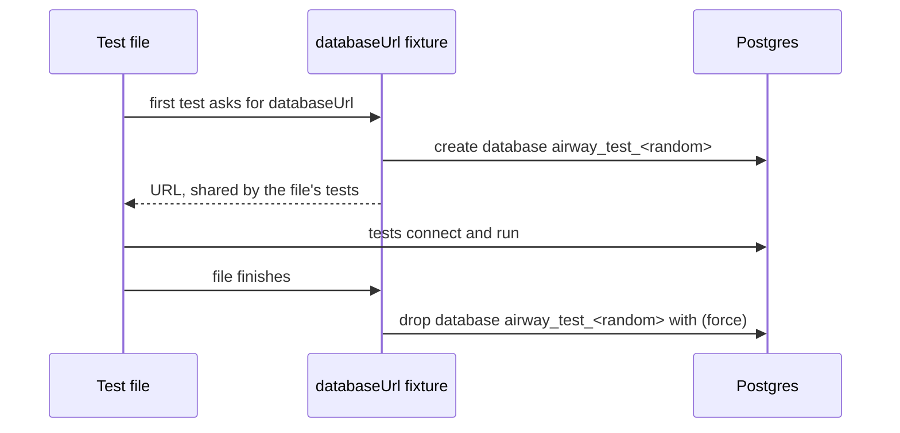

# Testing

Tests go where logic can be wrong: parsing, scoring, time math, the SQL path, permissions, and data writes. Trivial wiring, such as "this file exists" or "this route is registered", gets no test. Every test uses synthetic data; real CPAP data never goes in the repo.

## Running tests

Vitest runs two projects, both defined in `vitest.config.ts`:

| Project | Command | What it runs |
|---|---|---|
| `unit` | `pnpm test` (also part of `pnpm check`) | Every `*.test.ts` and `*.test.tsx` except database tests |
| `db` | `pnpm test:db` | Every `*.db.test.ts`, against a real Postgres 18 |

Files, and the tests inside them, run in a random order, so a test that depends on another running first fails. A failing run prints its seed, and `pnpm test --sequence.seed=<seed>` replays that order.

The `unit` project shares one module registry across files, which saves starting a fresh one per file. A test that sets up process-wide state, such as starting an OpenTelemetry SDK that registers global providers, would leak that state into other files. Such tests get their own project with isolation on.

## Where tests go

A package's tests live in its `tests/` folder and mirror `src/`: the tests for `src/query/compile.ts` go in `tests/query/compile.test.ts`. The repo's own tooling tests, such as the lint fixture test, live in the top-level `tests/`.

Helpers that more than one package's tests need go in `@airway/testing`, imported as `@airway/testing/<file>`.

## Database tests

A database test is named `*.db.test.ts` and imports `test` from `@airway/testing/postgres` instead of from Vitest. That `test` adds a `databaseUrl` fixture: the connection URL of an empty database that belongs to the test file.

```ts
import { expect } from "vitest";
import { test } from "@airway/testing/postgres";

test("writes a row", async ({ databaseUrl }) => {
  // Connect to databaseUrl; it's empty and no other test file sees it.
});
```



The database is dropped with `force`, so a connection a test forgot to close doesn't block cleanup.

### Postgres locally

`pnpm db:up` runs Postgres 18 in Podman, published on `127.0.0.1:54318` with the password `airway`, and `pnpm db:down` stops and removes it. Nothing is kept between runs. To use another server, set `AIRWAY_TEST_POSTGRES_URL` to a URL for a role that can create databases, ending in `/postgres`.

If Postgres isn't reachable, the first database test fails with a message that says so.

### Postgres in CI

The `Database tests` job runs the same image as a service container. The image is pinned by digest in two places, `package.json`'s `db:up` script and `.github/workflows/ci.yml`, and both must name the same digest.

## The lint fixture test

`tests/lint.test.ts` checks that every lint rule still reports. [Development](development.md#lint-and-format) explains why and how to update it.
