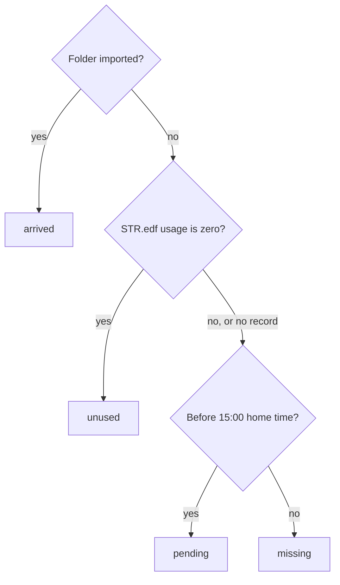

# Trends

The trends page and the night summaries behind it.

The page and the summary service aren't built yet. The contract already defines how nights combine and what the summary procedures return.

## How nights combine

The trends page shows a night, a week, or a month per step, and `summarize_nights` gives agents the same figures. A week or month combines its nights the way OSCAR combines a date range. Each nights metric says how in the registry, as `combine` on its column, so every nights column can be summarized and no caller decides it separately. The column type requires it, so a nights metric without one doesn't compile.

| Columns | `combine` | A week's value |
|---|---|---|
| Per-hour indexes: `ahi`, `hi`, `ai`, `oai`, `cai`, `uai`, `rin` | `rate` | The nightly values averaged with each night weighted by its usage hours |
| The machine's percentiles, such as `leak_p95` | `median` | The median of the nightly values: a typical night |
| The machine's maxima, such as `leak_max` | `max` | The highest nightly value |
| Durations and counts, such as `usage` and `obstructive_apneas` | `mean` | The mean per used night, on the same scale as one night |

Weighting an index by usage gives the week's total events over its total hours. A plain average would count a two-hour night the same as a nine-hour one. The weighting uses the machine's own nightly scores, so a week with one used night shows exactly that night's index.

A week's median leak P95 answers "how high did leak get on a typical night?" It isn't the P95 of every sample in the week. airway computes that figure only for leak and mask pressure, as the next paragraph describes.

Only used nights combine: nights with STR.edf usage above zero. Each bucket reports how many of its nights fall in the range and how many were used, so a half-empty week is visible. A bucket with no used nights has nulls, never zeros.

Week and month buckets also carry the leak and mask-pressure percentiles recomputed from the 2 s samples, for the dashed line beside the machine's. Ingest stores these, so a summary only reads them.

## Summary procedures

`@airway/contract/api/summary` defines the shapes.

| Procedure | Takes | Returns |
|---|---|---|
| `summary.range` | `SummaryRange`: `{from, to, step}` | `RangeSummary`: a bucket for every step in the range, empty ones included, and the trends link |
| `summary.lastNight` | nothing | `LastNightSummary`: last night's status, and its numbers and upload time once it has arrived |
| `summary.settingsChanges` | `NightRange`: `{from, to}` | each `SettingChange` in the range, in the device's units |

`step` is `night`, `week` (ISO weeks starting Monday), or `month`. The trends page's toggle, its URLs, and `summarize_nights` all use these values; the toggle labels `night` as "Day".

## Last night

`@airway/contract/api/last-night` decides whether last night's data is here. Ingest's data-missing metric, `summary.lastNight`, and the Last night card all call it, so the 15:00 cutoff is defined in one place.

`lastNightKey(now, zone)` is today's date in the home time zone, minus one day. `dataMissing(strDay, folderImported, now, zone)` returns one of four statuses:

A night with no STR.edf record counts as used. STR.edf arrives with each upload, so a missed upload also leaves it without last night's record, and that night should show as missing, not unused. The latest uploads finish around 13:30, so 15:00 leaves an hour and a half of margin.
