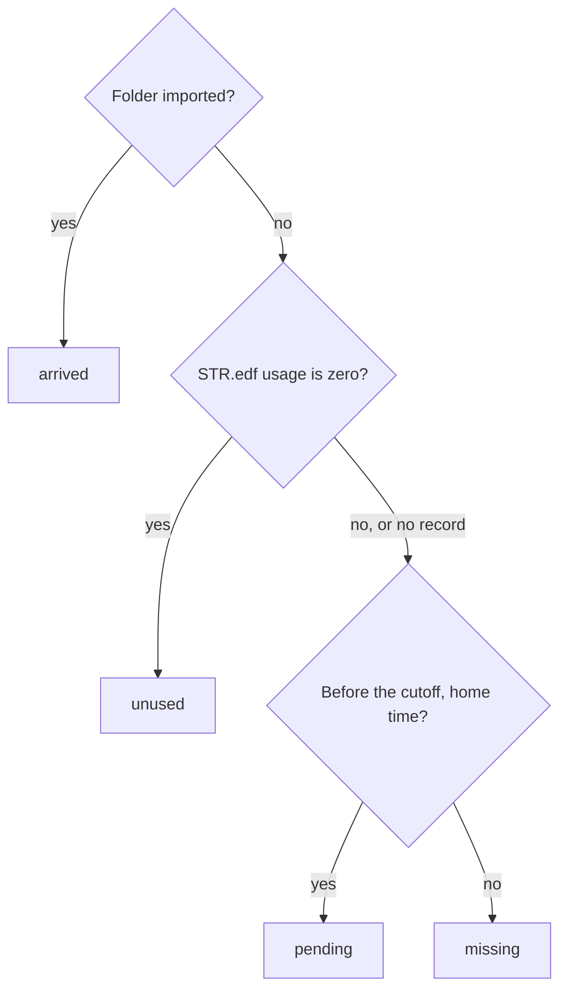

# Trends

This page covers airway's trends page and the summary procedures that supply its figures.

The page and the summary service aren't built yet. The contract already defines how nights combine and what the summary procedures return.

## How nights combine

Each point on the trends page covers a night, a week, or a month, and `summarize_nights` returns the same figures to agents. A week or month combines its nights the way OSCAR combines a date range. The registry sets `combine` on every nights column, and `combine` names the way a week or month combines that column. Callers read `combine` from the registry, so they all summarize a column the same way. The column type requires `combine`, so a nights column that omits `combine` fails to compile.

| Columns | `combine` | A week's value |
|---|---|---|
| Per-hour indexes: `ahi`, `hi`, `ai`, `oai`, `cai`, `uai`, `rin` | `rate` | The nightly values averaged with each night weighted by its usage hours |
| The machine's percentiles, such as `leak_p95` | `median` | The median of the nightly values, which is the value on a typical night |
| The machine's maxima, such as `leak_max` | `max` | The highest nightly value |
| Durations and counts, such as `usage` and `obstructive_apneas` | `mean` | The mean per used night, on the same scale as one night |

Weighting an index by usage gives the week's total events over its total hours. A plain average would count a two-hour night the same as a nine-hour one. The weighting uses the machine's own nightly scores, so a week with one used night shows exactly that night's index.

A week's median leak P95 answers "how high did leak get on a typical night?" The P95 of every sample in the week is a separate figure. airway computes it only for leak and mask pressure, as the last paragraph of this section describes.

A week or month combines only its used nights, which are the nights with STR.edf usage above zero. Each bucket reports how many of its nights fall in the range and how many were used, so a reader can spot a half-empty week. Every metric in a bucket with no used nights is null.

Week and month buckets also include leak and mask-pressure percentiles that airway recomputes from the 2 s samples. The trends page draws them as a dashed line beside the machine's percentiles. Ingest stores these, so a summary only reads them.

## Summary procedures

`@airway/contract/api/summary` defines what each procedure takes and returns.

| Procedure | Takes | Returns |
|---|---|---|
| `summary.range` | `SummaryRange`: `{from, to, step}` | `RangeSummary`: a bucket for every step in the range, including empty buckets, and a link to the trends page |
| `summary.lastNight` | nothing | `LastNightSummary`: last night's status, plus the night's numbers and arrival time once the night's data has arrived |
| `summary.settingsChanges` | `NightRange`: `{from, to}` | each `SettingChange` in the range, in the device's units |

`step` is `night`, `week` (ISO weeks starting Monday), or `month`. The trends page's toggle, its URLs, and `summarize_nights` all use these values; the toggle labels `night` as "Day".

## Last night

`@airway/contract/api/last-night` decides whether last night's data has arrived. Ingest's data-missing metric, `summary.lastNight`, and the Last night card all call it, so all three apply the same cutoff.

`lastNightKey(now, zone)` is today's date in the home time zone, minus one day. `dataMissing(strDay, folderImported, now, { zone, cutoff })` takes `cutoff`, which is `AIRWAY_DATA_MISSING_CUTOFF`, a time of day in the home time zone that defaults to 15:00 ([Configuration](configuration.md)). It returns one of four statuses:

A night with no STR.edf record counts as used. STR.edf arrives with the night's files. When the files haven't arrived, STR.edf has no record for last night either, so the night's status is `pending` before the cutoff and `missing` after it. Set the cutoff after the time a normal night's files arrive.
